<p align="center"></p>

<h1 align="center">OMR Checker: free offline OMR sheet scanner and answer sheet maker for Nepal CEE, NEET, JEE and school exams</h1>

<p align="center">
  <b>Make OMR answer sheets, scan them from any ADF scanner, and get marks, ranks and merit lists in minutes, all on one Windows PC with no internet and no fees.</b>
</p>

<p align="center">
  <a href="LICENSE"></a>
  
  
  
</p>

<p align="center">
  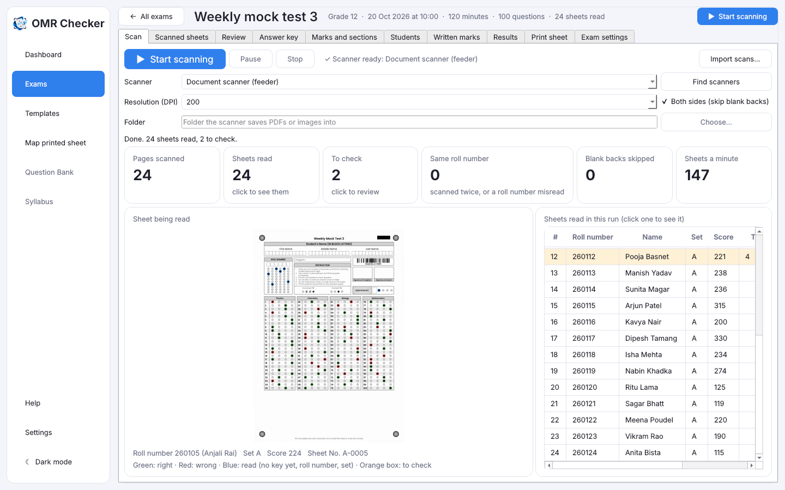
</p>

**OMR Checker** is free, open-source **OMR software** (optical mark recognition) for schools, colleges,
coaching institutes and exam centres. It designs and prints **OMR bubble sheets**, reads the filled
sheets from a **document scanner with an automatic document feeder (ADF)**, a watched folder or
scanned PDFs, grades them against your **answer key** with **negative marking**, and exports a
**merit list to Excel** and **PDF scorecards**. Ready-made layouts follow the question patterns of
**NEET, JEE Main, MECEE-BL / CEE (Nepal), KUUMAT, UPSC prelims, NDA, CTET, SSC, bank exams, CUET,
BCS, MDCAT** and more.

Everything stays on your PC. Nothing is uploaded, and there is no subscription or per-sheet charge.

## For Nepal: CEE (MECEE-BL) mock tests and more

OMR Checker comes with a ready-made **CEE / MECEE-BL pattern** for medical entrance mock tests in Nepal:
**200 questions** in Zoology (40), Botany (40), Chemistry (50), Physics (50) and MAT (20), four options
each, **+1 for a right answer and −0.25 for a wrong one**, with roll number and question set bubbles.
Coaching institutes, colleges and schools can print the sheets, scan a whole batch through the
feeder and publish a ranked merit list the same day, offline.

<p align="center">
  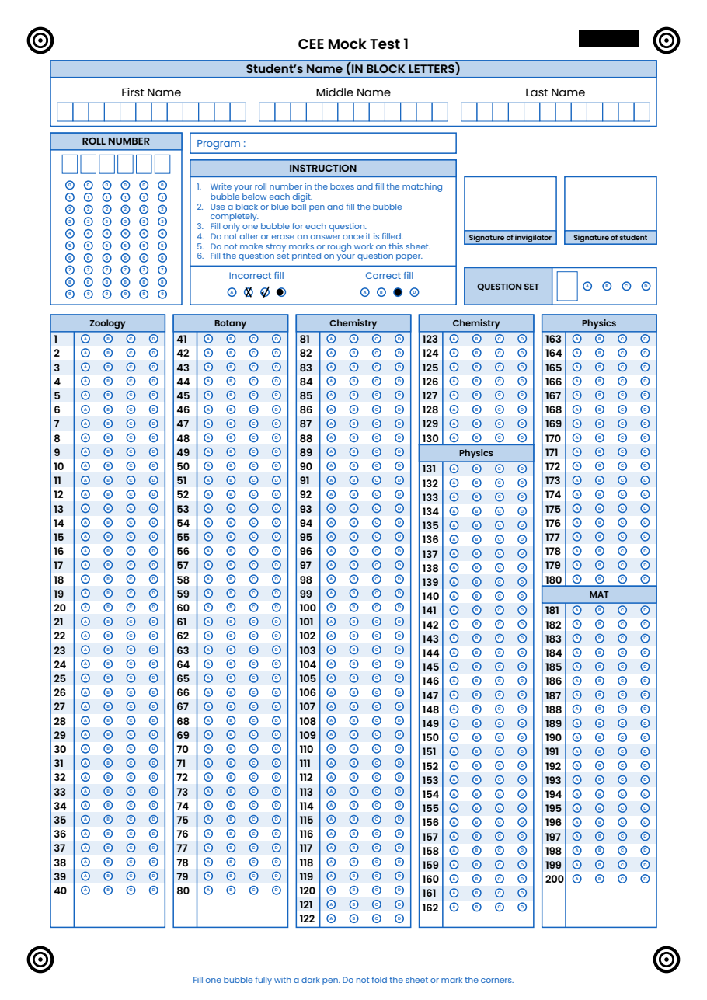
</p>

Other Nepali exam OMR patterns included:

| Template | Questions | Marking |
|---|---|---|
| CEE / MECEE-BL (medical entrance) | 200: Zoology 40, Botany 40, Chemistry 50, Physics 50, MAT 20 | +1 / −0.25 |
| KUUMAT | 100, in four parts of 25 | +1 / −0.25 |
| TU CMAT | 100: Verbal, Quantitative, Logical reasoning, General awareness | +1, no negative marking |
| IOE entrance mock | 100: Mathematics 30, Physics 30, Chemistry 25, English 15 | +1 / −0.1 |
| Lok Sewa practice | 100 | +1 / −0.2 |

These follow each exam's published question pattern and marking on OMR Checker's own sheet
design. They are **not the official answer sheets** of the Medical Education Commission, KU, TU,
IOE or the Public Service Commission. Check the marking for your year's exam, and change anything
on the **Templates** screen.

### Run a CEE mock test in 5 steps

1. **Exams > New exam…**, and under *Start from* pick **Nepal · MECEE-BL / CEE pattern**. Name the
   test (for example *CEE Mock Test 1*), add your institute's heading and logo, and **Create exam**.
2. **Print sheet > Print…** (or **Save as PDF…** for the print shop). Tick sheet numbers in the
   sheet's look if you want every copy numbered.
3. **Answer key**: type the 200 answers for each question set (A, B, C, D).
4. Put the filled sheets in the scanner's feeder and press **▶ Start scanning**.
5. Fix anything on **Review**, then on **Results** save the **merit list (Excel)**, the
   **scorecards (PDF)** or a CSV with the columns you choose.

## Contents

- [For Nepal: CEE (MECEE-BL) mock tests](#for-nepal-cee-mecee-bl-mock-tests-and-more)
- [Features](#features)
- [Screenshots](#screenshots)
- [Install](#install)
- [Quick start: your first exam in 5 steps](#quick-start-your-first-exam-in-5-steps)
- [Ready-made exam templates](#ready-made-exam-templates)
- [Accuracy and speed](#accuracy-and-speed)
- [FAQ](#faq)
- [Beginner's guide](docs/index.md) · [Cheat sheet](docs/cheat-sheet.md) · [User guide](docs/user-guide.md)
- [Contributing](#contributing) · [Licence](#licence)

## Features

**Make the answer sheet**
- Step-by-step **New exam** wizard: subjects and sections, 2 to 8 options, true or false, numeric
  answers (JEE-style digit bubbles), roll number up to 9 digits, up to 8 question paper sets.
- **OMR sheet generator**: your heading, logo, colour and instructions; bubbles as circles, ovals,
  pills or rectangles; options printed A–D, a–d or 1–4.
- **Print** directly or **save as PDF** on A4, Letter, Legal, A3 or A5.
- Optional **sheet number on every sheet** (A-0001, A-0002…), printed as a barcode and read back,
  so missing or repeated sheets show up.
- Already print your own sheets? **Map printed sheet** turns one scan into a template.

**Scan and read**
- **Start scanning** from any Windows (WIA) scanner with a feeder, both sides at once, blank backs
  skipped.
- **Live view**: each sheet appears as it is read, with right answers ringed green, wrong ones red,
  the missed right answer blue and anything doubtful boxed, plus a running list of roll numbers and
  scores. **Show every bubble position** checks the sheet lines up with the paper.
- Also reads a **folder your scanner software saves into**, and **scanned PDFs or images**
  (photocopies and phone photos too).
- Every page is **saved the moment it is read**, so a paper jam or power cut never loses a sheet.

**Check and grade**
- The reader **never guesses**: half-filled, faint or double marks go to **Review**, where one
  key press fixes them, and every change is logged.
- Answer key per set, typed, clicked, pasted, imported from CSV, or **read from a master sheet**.
- **Negative marking**, marks per section, partial marks for multi-correct questions, bonus and
  dropped questions, numeric answers.
- **Student list from Excel**: names on every result, unknown roll numbers flagged, absent list.

**Organise**
- **Programs and categories**: IOE, Medical, CMAT… each with its own exams, test series, colour and
  institute.
- **Student directory** with batches, email and phone, kept once for every exam; each student's
  **profile** with their trend and weakest sections, and **attendance** by batch.
- **Archive** finished exams; deleted exams wait in the **Trash** for 30 days.

**Results**
- Ranks and percentiles, scores per section and per topic, written (subjective) marks added in.
- **A mistake in the paper?** Accept either of two answers, give everyone the marks (bonus) or drop
  the question; every key change is logged and noted on the scorecards.
- **Merit list in Excel** with every answer coloured right or wrong, plus **item analysis**
  (difficulty and discrimination per question).
- **One PDF scorecard per student**, with your institute's letterhead, signature line and footer.
- **Marked sheets (PDF)**: each student's own sheet, coloured right, wrong and missed, one page each.
- **Student reports**: a page per student that opens offline in any phone browser (score, rank,
  section and topic bars, every question), plus a PDF, in a folder or one zip named by roll number.
- **Hindi, Marathi and Nepali** headings, instructions, names and letterheads print with their
  letters joined, on sheets, scorecards and marked sheets.
- **Scan with a phone**: a phone on the same Wi-Fi opens the PC's QR code and photographs sheets
  one after another, taking each by itself and saying the roll number read; no app or internet.
- **Several PCs on one exam**: scan on two or three PCs at once into the main PC's exam over your
  office network; pages wait safely on each PC until the main PC has them. Operator logins with PINs,
  and every correction logged under who made it.
- **Results website**: a folder to upload where each student opens their own report with their roll
  number and a private code that stays the same in every exam.
- **Institute branding**: name, logo, address, colour, motto and signature, kept once and used on
  sheets, scorecards, reports and Excel; several institutes, one default, a choice per exam.
- **Test series**: combined leaderboard over several tests, with each test's rank, places gained or
  lost, improvement, best-of-N and weights, and analysis by test and section.
- **A sheet for each student**: print every student's own sheet with their name written and their
  roll number bubbles already filled, so a roll number is never filled wrongly.
- **Send results by WhatsApp, email or SMS**: each student's chat opens in WhatsApp with their
  result typed in, ready to send; email (any server) and SMS (Twilio or your own gateway) once set
  up, with a preview, a test to yourself, sending limits, a send log, never sent twice.
- **Back up and restore** every exam in one file.

## Screenshots

All screenshots use sheets generated for testing; the names and marks are made up.

| | |
|---|---|
| 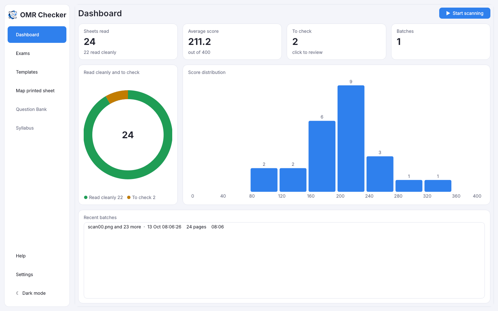 |  |
| **Dashboard**: sheets read, average score, what to check, score spread | **Live scanning** from the ADF, with the marks drawn on each sheet |
|  |  |
| **New exam** from a ready-made pattern (here NEET-UG) | **Sheet look**: colour, bubble shape, logo, instructions |
| 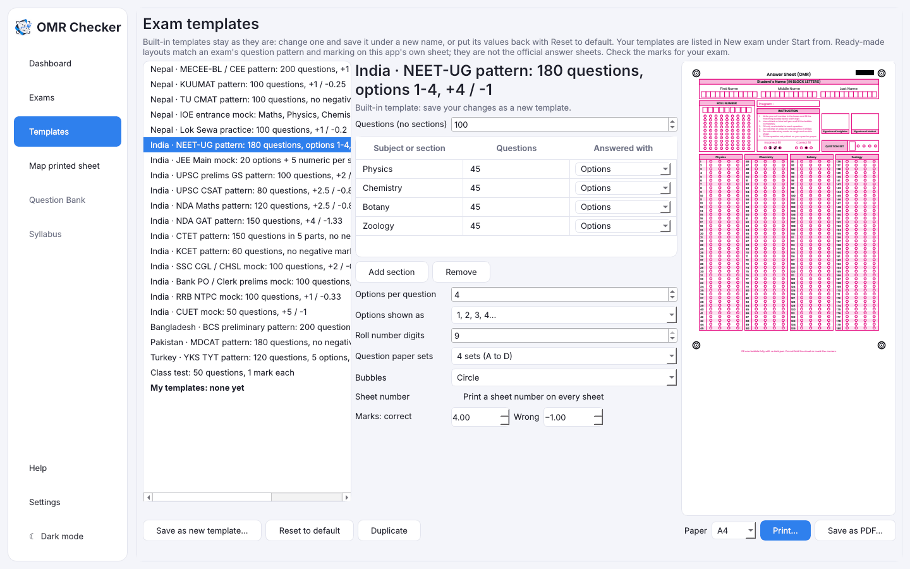 | 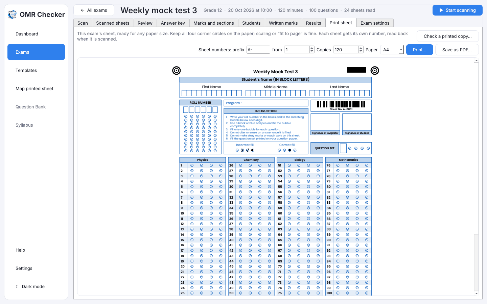 |
| **Templates**: edit a pattern and save it as your own | **Print** numbered sheets or **save as PDF** |
| 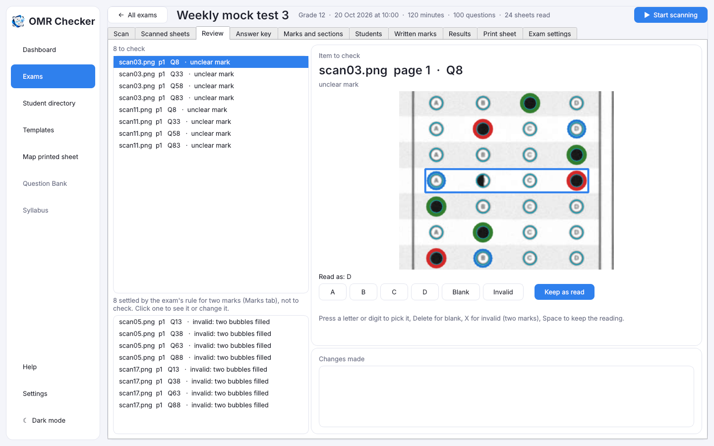 | 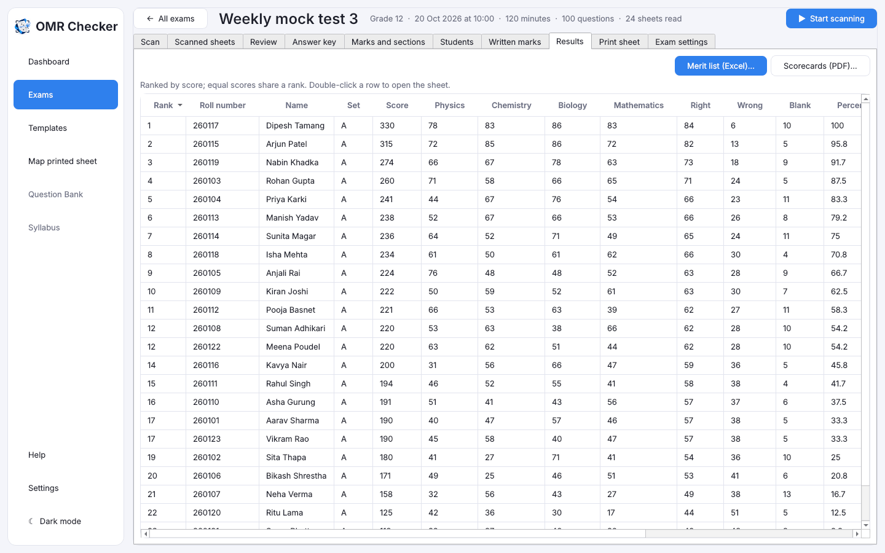 |
| **Review**: doubtful marks shown on the sheet, fixed with one key | **Results**: ranks, section scores, Excel and PDF export |
| 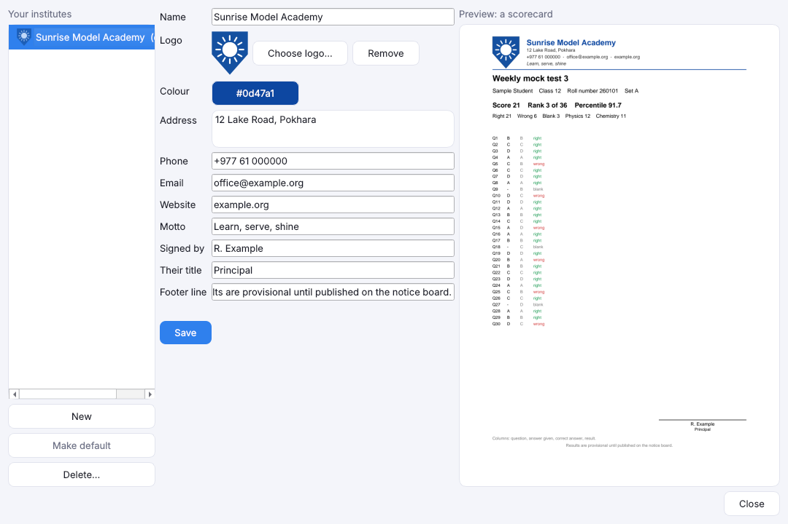 | 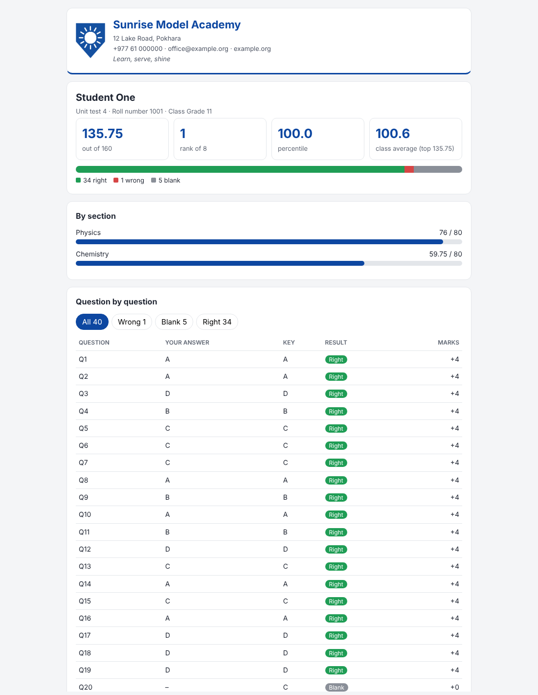 |
| **Institute branding** with a live scorecard preview | **Student report**: opens offline on any phone or computer |
| 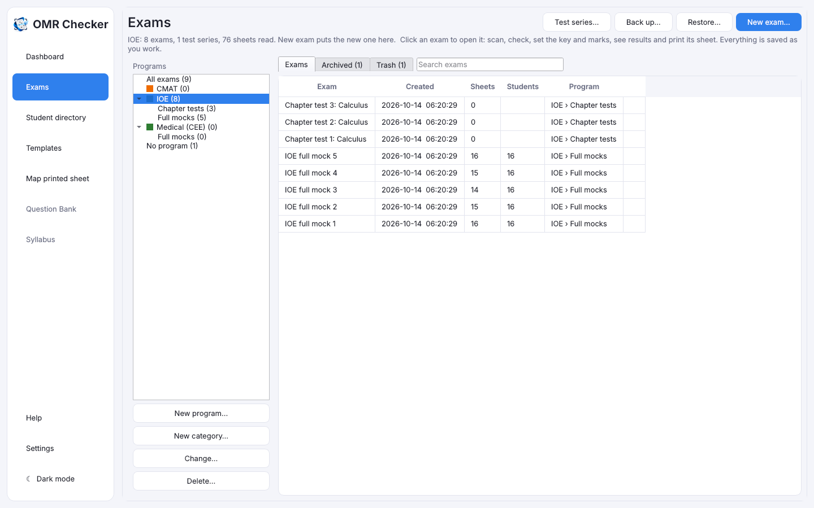 | 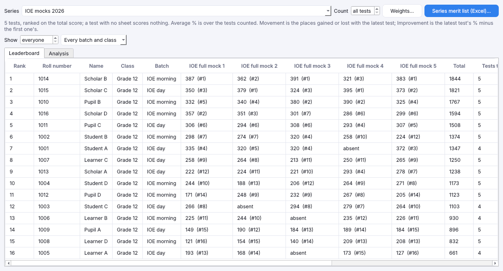 |
| **Programs and categories**, Archive and Trash | **Test series** leaderboard |

<details>
<summary>A printed answer sheet made by OMR Checker</summary>

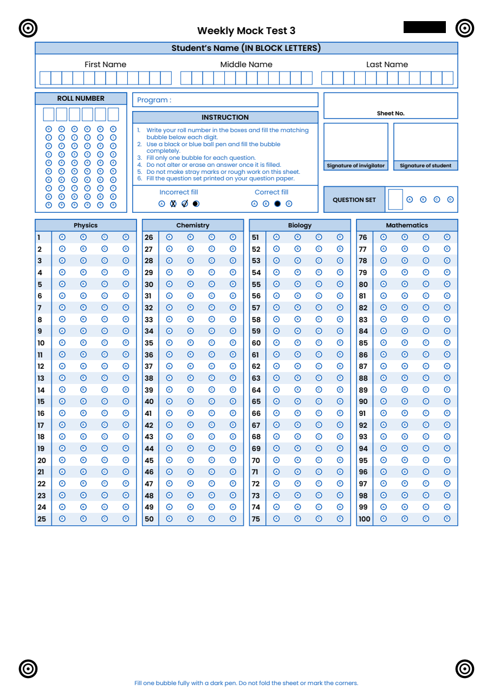

</details>

## Install

<p>
  <a href="https://github.com/crispin0007/omr/releases/latest"></a>
  <a href="https://github.com/crispin0007/omr/releases"></a>
</p>

Download from the [latest release](https://github.com/crispin0007/omr/releases/latest) (once one is
published) the file for your computer:

| Your computer | File | |
|---|---|---|
| Windows 10 or 11 (64-bit) | `OMR-Setup-<version>.exe` | Installer: Start menu, desktop shortcut, updates in place |
| Windows, no installing | `OMR-Portable-<version>.zip` | Unzip anywhere (a USB stick) and run `OMR.exe` |
| Mac with Apple Silicon (M1 or newer) | `OMR-Checker-<version>-macos-apple-silicon.dmg` | Open, drag OMR Checker to Applications |
| Mac with Intel | `OMR-Checker-<version>-macos-intel.dmg` | Open, drag OMR Checker to Applications |
| Ubuntu, Debian, Linux Mint | `omr-checker_<version>_amd64.deb` | Double-click, or `sudo apt install ./omr-checker_*.deb` |
| Any other Linux (64-bit) | `OMR-Checker-<version>-x86_64.AppImage` | Make it executable and run it; or use the `.tar.gz` |

`SHA256SUMS.txt` in each release lists every file's checksum. Python and every library are inside;
nothing else is needed.

### The first time you open it

The downloads are not signed with a paid certificate, so your computer asks once whether to trust
them:

- **Windows:** if a blue "Windows protected your PC" box appears, press **More info**, then
  **Run anyway**.
- **Mac:** in Applications, right-click (or Control-click) **OMR Checker** and choose **Open**, then
  **Open** again. On macOS 15 Sequoia or newer, if it only offers **Done**, press it, then open
  **System Settings > Privacy & Security**, scroll down and press **Open Anyway** next to
  "OMR Checker was blocked". The `.dmg` has these steps in a "First open - read me" file.
- **Linux AppImage:** right-click it > Properties > allow running as a program, or run
  `chmod +x OMR-Checker-*.AppImage`.

### Scanners

- **Windows:** any scanner Windows can use. If Windows Fax and Scan or the scanner's own app can scan
  with it, OMR Checker will find it and scan straight from the feeder.
- **Mac and Linux:** scan with the scanner's own software (or Image Capture, or Simple Scan) into a
  folder, and pick **A folder my scanner software saves into** on the Scan tab. Each file is read as
  soon as it is saved. **Import scans…** reads PDFs and images too.

### Updating and removing (Windows)

Installing a newer version over the old one keeps every exam and setting. Uninstalling (Settings >
Apps) asks whether to delete your exams too; the answer is No unless you choose Yes. The portable copy
keeps its exams and settings in a `data` folder beside `OMR.exe`, so the whole folder moves to another
PC.

### From source (Windows, macOS or Linux)

Python 3.11, 3.12 or 3.13 (64-bit):

```
git clone https://github.com/crispin0007/omr.git
cd omr
python -m venv .venv
.venv\Scripts\activate          # macOS and Linux: source .venv/bin/activate
pip install -e ".[app]"
omr
```

Scanning straight from a feeder needs Windows. On macOS and Linux, use a watched folder or import scans.
To build the downloads yourself, see [packaging/README.md](packaging/README.md).

## Quick start: your first exam in 5 steps

1. **Create the exam.** Exams > **New exam…**. Pick a pattern under *Start from* (or start blank),
   then name the exam and change anything you like. **Create exam**.
2. **Print the sheets.** On the exam's **Print sheet** tab press **Print…** or **Save as PDF…**.
   Use **Check a printed copy…** on one sheet before printing the rest.
3. **Enter the answer key.** On **Answer key**, click or type the right answers (one key per set).
4. **Scan.** Put the filled sheets in the feeder and press **▶ Start scanning** (on the Scan tab,
   at the top of the exam page, or on the Dashboard). Watch each sheet being read.
5. **Check and publish.** Fix anything on **Review**, then on **Results** export the merit list
   to Excel or print the scorecards.

New to OMR? The [beginner's guide](docs/index.md) explains every feature step by step in plain
words, and the one-page [cheat sheet](docs/cheat-sheet.md) prints for the scanner desk. The
[user guide](docs/user-guide.md) covers every screen in detail.

## Ready-made exam templates

These layouts follow each exam's published question pattern and marking, printed on OMR Checker's
own sheet design. They are **not the official answer sheets**. Check the marks for your exam.
Every template can be changed and saved under your own name on the **Templates** screen.

| Country | Templates |
|---|---|
| Nepal | MECEE-BL / CEE (200 questions, +1/−0.25), KUUMAT, TU CMAT, IOE entrance mock, Lok Sewa practice |
| India | NEET-UG (options 1–4, +4/−1), JEE Main mock (with numeric answers), UPSC prelims GS and CSAT, NDA Maths and GAT, CTET, KCET, SSC CGL/CHSL, bank PO/clerk prelims, RRB NTPC, CUET |
| Bangladesh | BCS preliminary (200 questions, −0.5) |
| Pakistan | MDCAT (180 questions) |
| Turkey | YKS TYT (5 options, −0.25) |
| Any | 50-question class test, or start blank |

## Accuracy and speed

Measured on our own test sheets with known answers (no private data):

| Kind of sheet | Bubbles read right | Silently wrong |
|---|---|---|
| Clean scan, 200 DPI | 100% | 0 |
| Fed crooked (3–6°), dim print, heavy JPEG compression | 100% | 0 |
| Phone photo (angled, shadowed) | 100% | 0 |
| Fed crooked and cropped so a corner mark is cut off | 100% of the half that reads; the rest refused with the reason | 0 |
| Real marking: pencil, half-filled and erased marks | 95.9%; every other mark sent to Review | 0 |
| Two real scanned 200-question sheets (kept private) | 200/200 photocopy, 199/200 phone photo (the one miss flagged) | 0 |

- **Speed:** about **900 sheets a minute** read and saved on a 4-core PC (about 250 on one core),
  faster than a scanner can feed. Reading uses every core but one, so the app stays responsive.
  Scanning speed is set by your scanner.
- **Big batches:** 1,000 sheets make a database of about 370 MB; the Excel merit list for 1,000
  students saves in about 3 seconds.
- **Cut or folded corners:** a page whose corner mark is cut off, or whose bubbles don't line up
  with its corner marks, is refused with that reason and kept under Review, never read shifted.
  Keep all four corner marks on the paper.

## FAQ

**Is OMR Checker really free?**
Yes. It is open source under the Apache-2.0 licence: free for schools, coaching institutes and
companies, with no per-sheet or yearly fee.

**Does it need the internet?**
No. It runs entirely on your PC and never uploads sheets or results.

**Which scanners work?**
Any scanner Windows can use through WIA, ideally one with an automatic document feeder (ADF) for
speed. If yours only works with its own software, let that software save into a folder and pick
**A folder my scanner software saves into**.

**Can I use my existing printed OMR sheets?**
Yes. **Map printed sheet** turns one scan of your sheet into a template: click the four corner
marks and box the bubble blocks.

**Can it read a mobile phone photo of an OMR sheet?**
Yes. Press **Scan with a phone…** and point a phone on the same Wi-Fi at the QR code: it takes
each sheet by itself as you put it down and says the roll number read. Photos you already have
can be imported too. For thousands of sheets a scanner's feeder is still faster.

**Does it support negative marking, sections and multiple sets?**
Yes: marks for right, wrong and blank per section, up to 8 question paper sets with a key each,
bonus and dropped questions, partial marking and numeric answers.

**What happens with a half-filled or double bubble?**
It is never guessed. It goes to **Review**, where you see that part of the sheet and decide with
one key press. Every change is logged.

**Can I export results to Excel?**
Yes: a merit list with ranks, section scores and every answer coloured, an item analysis sheet,
and a CSV of all answers. Scorecards export as PDF.

## Project layout

```
src/omr_core/   reading engine, grading, sheet maker, storage (no UI)
src/omr_app/    PySide6 desktop app
templates/      bundled sheet templates
tests/          pytest suite; sheets are generated by tests/sheets.py
specs/          one folder per feature: spec, plan, tasks
docs/           beginner's guide, cheat sheet, user guide and screenshots
```

Rules for changes are in [AGENTS.md](AGENTS.md) and the
[constitution](.specify/memory/constitution.md). Specs:
[phase 1](specs/001-omr-checking-mvp/spec.md), [question bank (planned)](specs/003-question-bank/spec.md).

## Contributing

Bug reports, scanner reports and pull requests are welcome. See [CONTRIBUTING.md](CONTRIBUTING.md).
Please don't attach scans of real students' sheets to issues.

## Licence

[Apache License 2.0](LICENSE): anyone, including schools and companies, can use, change and
redistribute the software, with an explicit patent grant.

Printed sheets use the Poppins font, under the SIL Open Font License
([src/omr_core/fonts/OFL.txt](src/omr_core/fonts/OFL.txt)), and Noto Sans Devanagari for Hindi,
Marathi and Nepali text, under the same licence
([src/omr_core/fonts/OFL-NotoSansDevanagari.txt](src/omr_core/fonts/OFL-NotoSansDevanagari.txt)).
