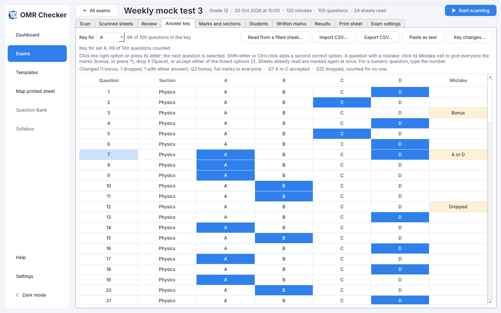

# The answer key

[Guide home](index.md) · Previous: [Several PCs on one exam](several-pcs.md) · Next: [Marks, sections, topics and written marks](marks-and-sections.md)

The **answer key** is the list of right answers. Open the exam's **Answer key** tab. Every
question has a row with its section and options.

## Enter the answers by clicking or typing

- **Click** the right option, or **press its letter** (A, B, C…). The next question is selected
  for you, so you can type a whole key quickly: `A`, `C`, `B`, `D`…
- **Arrow keys** move up and down.
- A question where the student must fill **both of two answers**: hold **Shift** and press the
  second letter, or **Ctrl+click** it.
- A **numeric** question: type the number, or click it. 042 and 42 count as the same answer.

Scores on the other tabs update as you go. If the key is shorter than the sheet, only the questions
with an answer are counted.

## A question had a mistake

Sometimes a question is printed wrong, has no right answer, or has two. Click that question's
**Mistake** cell and pick what to do:

| Choice | What happens | Key |
|---|---|---|
| **Bonus** | Everyone gets the full marks for it, whatever they filled: right, wrong, blank or two bubbles. | `*` |
| **Drop** | It counts for no one. The total goes down (100 marks becomes 99), so percentages are out of the new total. | Space |
| **Either ticked option is right** | Tick both right options first (Ctrl+click), then pick this. A student who filled *either one* gets the marks. Filling both is still two answers on a one-answer question, so it gets nothing (and no negative mark). | `/` |

For a numeric question, **Accept more than one number** takes the numbers with `/` between them,
such as `42/43`.

Sheets already scanned are marked again at once. Results, ranks, section totals, the dashboard,
scorecards and the Excel and CSV exports all use the changed key. Nothing needs to be scanned again.

The changed questions show in orange in the grid, with a summary above it, such as *1 bonus, 1
dropped*. Scorecards print a line saying which questions were changed, and the Excel file gets a
**Key changes** sheet.

Each set has its own key, so if the questions are in a different order in each set, change the
question in every set's key (pick the set in **Key for**).

### Undo a change

Click the question's **Mistake** cell and pick **Undo the last change**. Or press **Key changes…**
to see every change, with who made it and when. Select one and press **Undo this change**.
Answers typed in for the first time aren't listed. Every change after that is.

## One key per set

If your exam has question paper sets, pick the set in **Key for** at the top and enter its key.
Each student's sheet is marked against the key of the set they filled.

## Other ways to give the key

- **Paste as text**: type or paste one letter per question, such as `ABDCA…`. Separate the answers with commas when one is a bonus `*`, dropped `-`, either-or `A/C` or needs both `AC`. For several sets,
  one line per set: `A: ABDC…`. On a numeric question the digits go together: `ABC42D`.
- **Import CSV…**: a spreadsheet with the columns `set,question,answer` (`set` may be left out).
  **Export CSV…** saves the key the same way.
- **Read from a filled sheet…**: fill a blank answer sheet with the right answers (a *master
  sheet*), scan it, and pick the file. Its set code picks the set. Any unclear or double mark is
  left empty for you to click.

[Guide home](index.md) · Next: [Marks, sections, topics and written marks](marks-and-sections.md)
