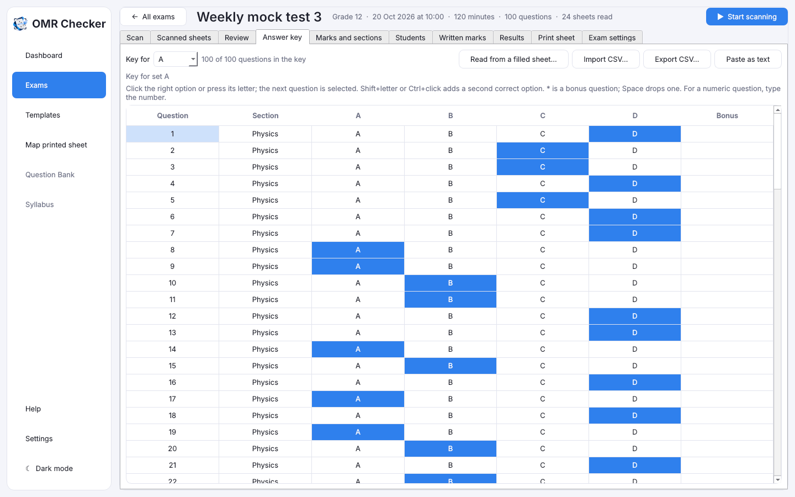

# The answer key

[Guide home](index.md) · Previous: [Scan the filled sheets](scanning.md) · Next: [Marks, sections, topics and written marks](marks-and-sections.md)

The **answer key** is the list of right answers. Open the exam's **Answer key** tab. Every
question has a row with its section and options.

## Enter the answers by clicking or typing

- **Click** the right option, or **press its letter** (A, B, C…). The next question is selected
  for you, so you can type a whole key quickly: `A`, `C`, `B`, `D`…
- **Arrow keys** move up and down.
- A question with **two right answers**: hold **Shift** and press the second letter, or
  **Ctrl+click** it.
- **`*`** makes a **bonus** question: everyone gets the marks.
- **Space** **drops** a question: it counts for nobody.
- A **numeric** question: type the number, or click it. 042 and 42 count as the same answer.

Scores on the other tabs update as you go. If the key is shorter than the sheet, only the questions
with an answer are counted.

## One key per set

If your exam has question paper sets, pick the set in **Key for** at the top and enter its key.
Each student's sheet is marked against the key of the set they filled.

## Other ways to give the key

- **Paste as text**: type or paste one letter per question, such as `ABDCA…`. For several sets,
  one line per set: `A: ABDC…`. On a numeric question the digits go together: `ABC42D`.
- **Import CSV…**: a spreadsheet with the columns `set,question,answer` (`set` may be left out).
  **Export CSV…** saves the key the same way.
- **Read from a filled sheet…**: fill a blank answer sheet with the right answers (a *master
  sheet*), scan it, and pick the file. Its set code picks the set. Any unclear or double mark is
  left empty for you to click.

[Guide home](index.md) · Next: [Marks, sections, topics and written marks](marks-and-sections.md)
