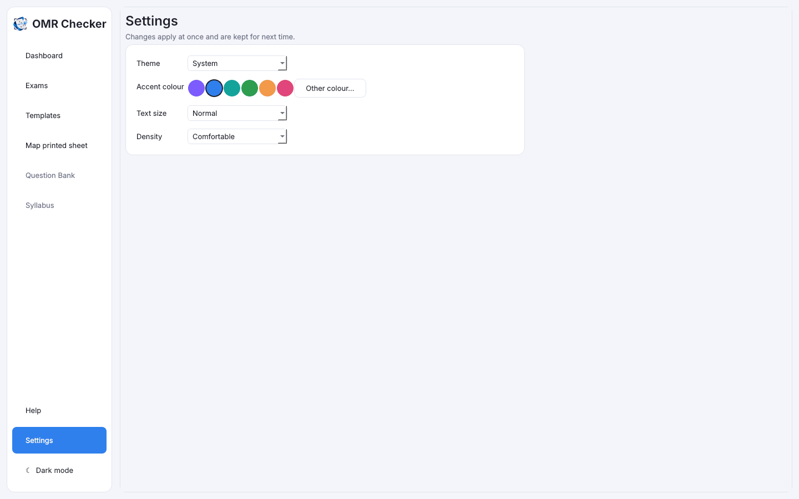

# Backup, restore and settings

[Guide home](index.md) · Previous: [Results](results.md) · Next: [Troubleshooting](troubleshooting.md)

## Everything saves by itself

There is no Save button for your work. Each page is saved the moment it is read, and the answer key
and marks are saved as you type. Close the app at any time; it opens the last exam next time.

Your exams are kept in one file on this PC:
`%LOCALAPPDATA%\OMR\omr.db`
(paste that into the address bar of File Explorer to open the folder). Help (F1) shows the folder
too.

## Back up

A **backup** is a copy of all your exams in one file, in case the PC breaks or you move to a new one.

On **Exams**, press **Back up…** and choose where to save. Every exam is saved with its sheets,
corrections and students.

Keep the backup somewhere other than the PC itself: a USB drive, or another computer.
Back up after every exam.

## Restore

On **Exams**, press **Restore…** and pick a backup file. Its exams are **added**: exams already on
this PC are left exactly as they are. Use this to move to a new PC: back up on the old one, install
OMR Checker on the new one, and restore.

## Delete an exam

On the exam's **Exam settings** tab, **Delete exam…** removes the exam and every sheet read for it.
It asks first. Back up before deleting if you might need it again.

## Settings

Open **Settings** in the sidebar. Changes apply at once and are kept for next time.

- **Theme**: System (follows Windows), Light or Dark. The button at the bottom of the sidebar
  switches between light and dark quickly.
- **Accent colour**: the colour of buttons and highlights. **Other colour…** picks any colour.
- **Text size**: Small, Normal or Large.
- **Density**: Compact fits more on the screen; Comfortable has more space.

Scanner settings (scanner, resolution, both sides) are on each exam's **Scan** tab; see
[Scan the filled sheets](scanning.md).

[Guide home](index.md) · Next: [Troubleshooting](troubleshooting.md)
