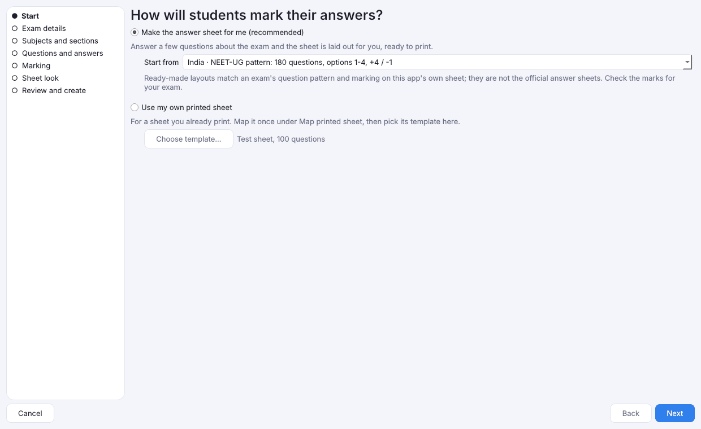
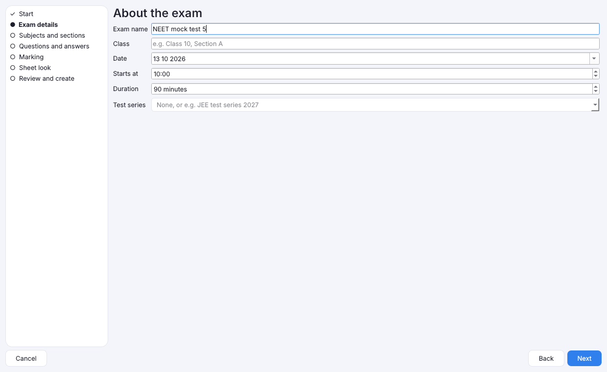
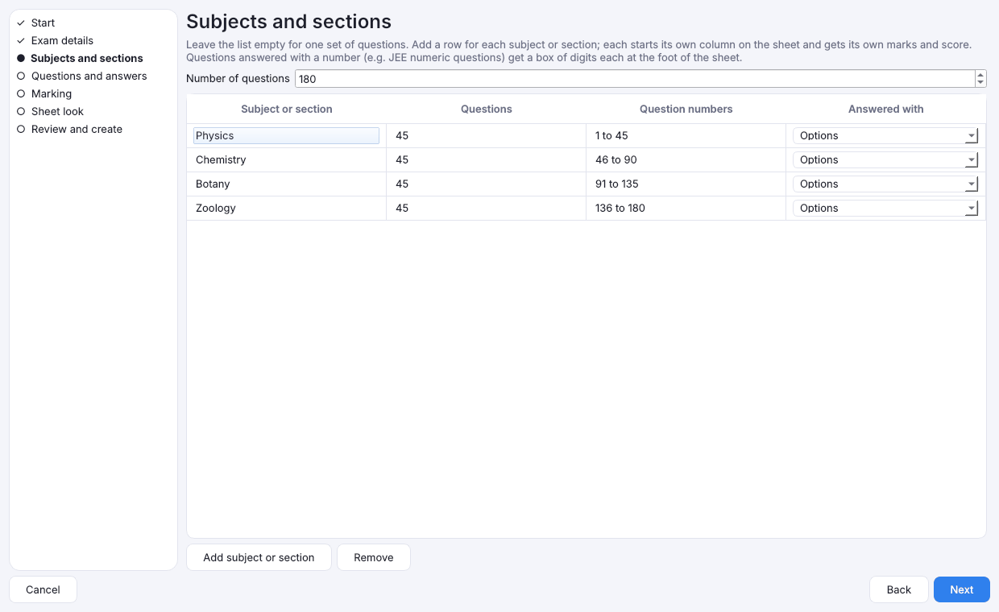
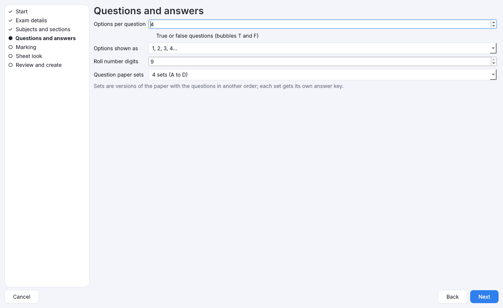
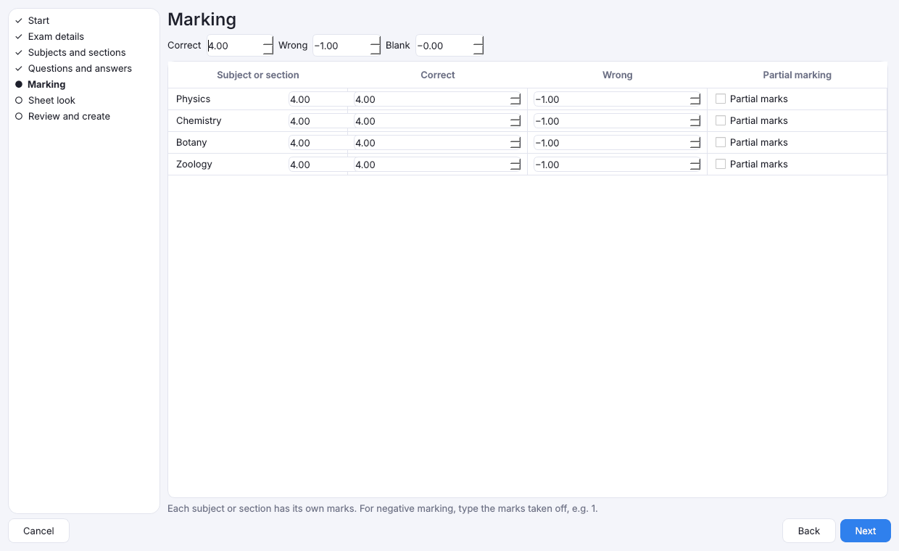
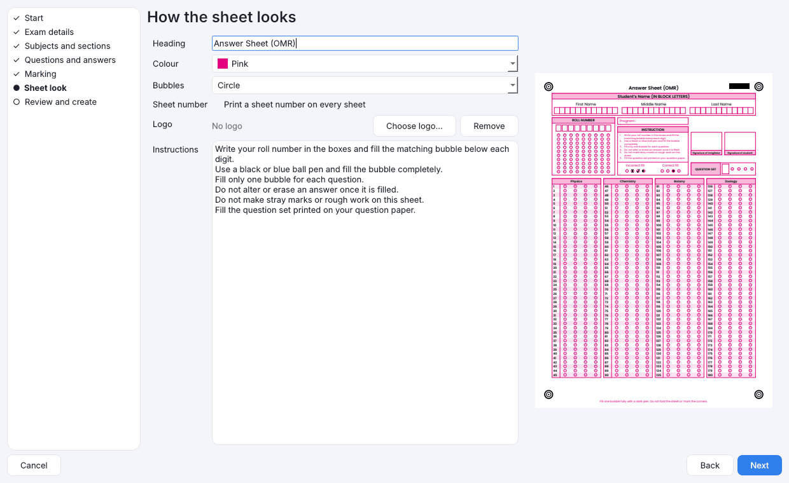
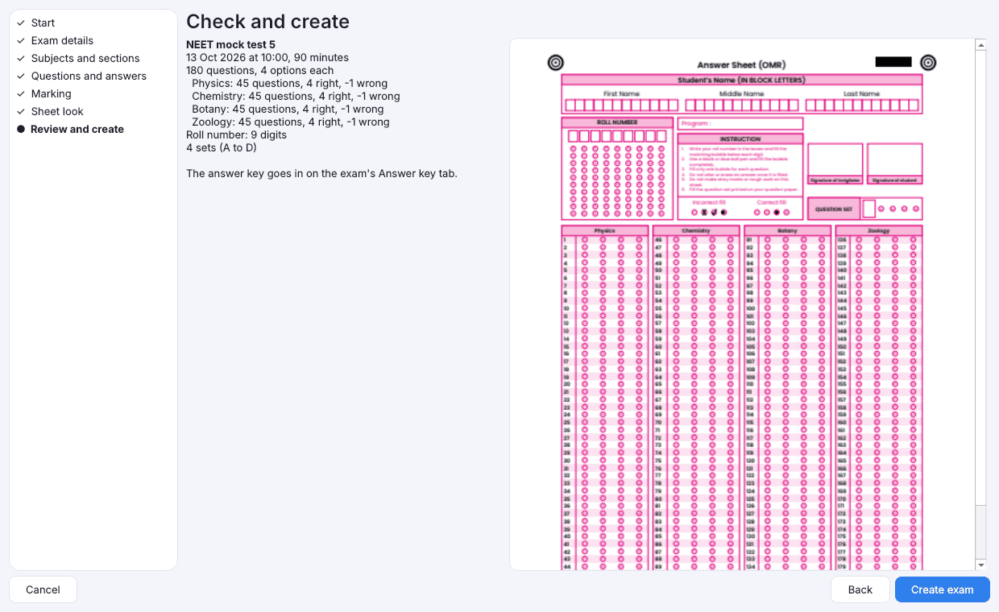
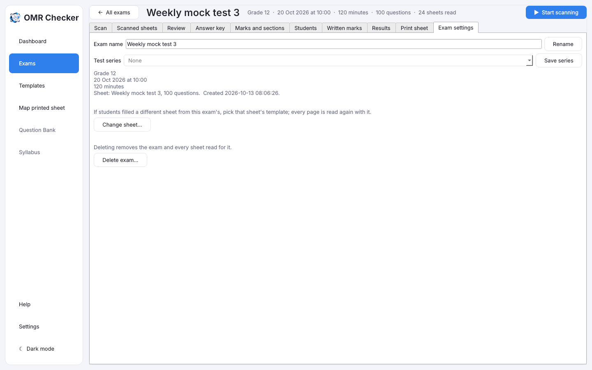

# Create an exam

[Guide home](index.md) · Previous: [Quick start](quick-start.md) · Next: [Programs and categories](programs.md)

An **exam** in OMR Checker holds everything for one test: its answer sheet, the answer key, the
marks, the scanned sheets and the results. You make one with **New exam…**.

## Open New exam

On **Exams**, press **New exam…** (or press **Ctrl+N** anywhere). A window opens with the steps
listed on the left. **Next** and **Back** move between them; **Cancel** closes the window without
making anything.

The app checks each step before letting you go on. If something is missing, it tells you what
right there.

## Step 1: Start

Choose how students will mark their answers:

- **Make the answer sheet for me (recommended)**: the app designs the sheet from your answers to
  the next steps.
- **Use my own printed sheet**: for a sheet you already print. You must map it once first; see
  [Use a sheet you already print](map-printed-sheet.md). Then press **Choose template…** and pick
  it. Some steps are skipped, because your sheet is already designed.

**Start from** fills in every step from a ready-made pattern, such as NEET-UG or a 50-question
class test. You can still change anything afterwards. See [Templates](templates.md) for the list.

## Step 2: Exam details

Type the **Exam name** (for example *Class 10 Science Unit Test 2*). **Class**, **Date**,
**Starts at** and **Duration** are optional and print on the sheet.

**Test series** is for a set of tests you want to rank together, such as weekly mock tests. Give
every test in the series the same name. See [Results](results.md#test-series).

## Step 3: Subjects and sections

- For a simple test, leave the list empty and type the **Number of questions**.
- For a test with subjects, press **Add subject or section** for each one and give it a name and
  its questions, for example *Physics, 1 to 50*. Each starts its own column on the sheet and gets
  its own score.
- A question answered with a **number** instead of options (like JEE numeric questions) gets a
  small box of digit bubbles at the foot of the sheet. Choose that kind for its section.

**Remove** deletes the selected row.

## Step 4: Questions and answers

- **Options per question**: 2 to 8. Most tests use 4.
- **True or false questions**: tick this for bubbles marked T and F.
- **Options shown as**: A B C D, a b c d, or 1 2 3 4.
- **Roll number digits**: how long your roll numbers are, up to 9 digits.
- **Question paper sets**: how many versions of the paper you print (1 if you don't use sets).

## Step 5: Marking

Type the marks for a **Correct**, **Wrong** and **Blank** answer. For negative marking, type the
marks taken off for a wrong answer, for example 0.25.

**Partial marking** is for questions with more than one right option: a student who picks some of
the right options, and no wrong one, gets part of the marks.

With sections, each section can have its own marks in the table.

## Step 6: Sheet look

- **Heading**: your school or exam name, printed at the top. It can be in Hindi or another
  Devanagari language, as can the instructions: see [Sheets in Hindi](print-sheets.md#sheets-in-hindi-marathi-or-nepali).
- **Colour** and **Bubbles** (pill, oval, circle, rounded or rectangle).
- **Sheet number**: tick **Print a sheet number on every sheet** to give every printed copy its
  own number. See [Sheet numbers](print-sheets.md#sheet-numbers).
- **Logo**: **Choose logo…** adds a picture; **Remove** takes it off.
- **Instructions**: a few lines for students, such as *Use a black ball pen*.

The preview on the right updates as you change things.

## Step 7: Review and create

Check the summary and the sheet. Press **Back** to change anything, or **Create exam**.

The exam opens on its own page, with the sheet ready to print.

## Change things later

- **Marks and sections** changes the marks at any time; see
  [Marks, sections, topics and written marks](marks-and-sections.md).
- **Exam settings** renames the exam, changes its test series, or deletes it. **Duplicate…** makes a
  new exam under a name you type, with the same sheet, sections, marks, test series and program. The
  copy starts with no answer key, no sheets read and no students, and its date is left for you to set.
  **Change sheet…** is for when students filled a different sheet; every page is read again.

[Guide home](index.md) · Next: [Programs and categories](programs.md)
