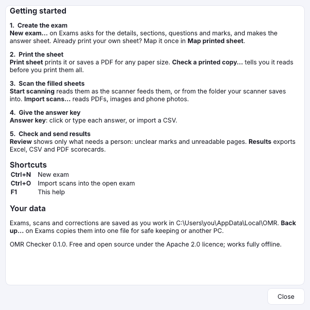

# OMR Checker beginner's guide

This guide explains OMR Checker in plain words, one topic per page. You don't need to know anything
about computers or OMR to follow it. Every page shows the screen it talks about.

**New here?** Read [Words to know](words-to-know.md) first (5 minutes), then do the
[Quick start](quick-start.md) with a few practice sheets.

**Running a CEE (MECEE-BL) mock test in Nepal?** Pick **Nepal · MECEE-BL / CEE pattern** under
*Start from* in [Create an exam](create-an-exam.md): 200 questions in Zoology, Botany, Chemistry,
Physics and MAT, +1 / −0.25, ready to print. KUUMAT, TU CMAT, IOE and Lok Sewa practice patterns are
there too; see [Templates](templates.md).

## The pages

**Start here**
1. [Words to know and installing](words-to-know.md): what OMR, an answer key, a template and an ADF
   are, and how to install the app.
2. [Quick start: your first exam](quick-start.md): the whole job in 5 steps.

**Before the exam**

3. [Create an exam](create-an-exam.md): the New exam steps, one screen at a time.
4. [Programs and categories](programs.md): IOE, Medical, CMAT… each with its own exams.
5. [Templates](templates.md): ready-made exam patterns and your own.
6. [Print the answer sheets](print-sheets.md): printing, saving a PDF, and sheet numbers.
7. [Use a sheet you already print](map-printed-sheet.md): Map printed sheet.

**After the exam**

8. [Scan the filled sheets](scanning.md): the scanner, a folder, or files, and the live view.
9. [The answer key](answer-key.md): giving the right answers.
10. [Marks, sections, topics and written marks](marks-and-sections.md): how scores are worked out.
11. [Review: checking unclear marks](review.md): what the app wasn't sure about.
12. [Students](students.md): names from Excel, and who was absent.
13. [Results, Excel, scorecards and test series](results.md): sharing the results.
14. [Send results by email or SMS](sending.md): each student's result, from your own account.
15. [Your institute](institute.md): name, logo and letterhead on scorecards and exports.

**Looking after your data**

16. [Backup, restore and settings](backup-and-settings.md): keeping exams safe, moving PCs, the look
    of the app.

**When something goes wrong**

17. [Troubleshooting](troubleshooting.md): problems and how to fix them.
18. [FAQ](faq.md): short answers to common questions.

**On paper**

19. [Cheat sheet](cheat-sheet.md): one printable page to keep next to the scanner.

## Where to find help in the app

Press **F1** (or **Help** in the sidebar) at any time. It shows the five main steps and the
keyboard shortcuts.

The [user guide](user-guide.md) has the same information in a denser form for experienced users.
