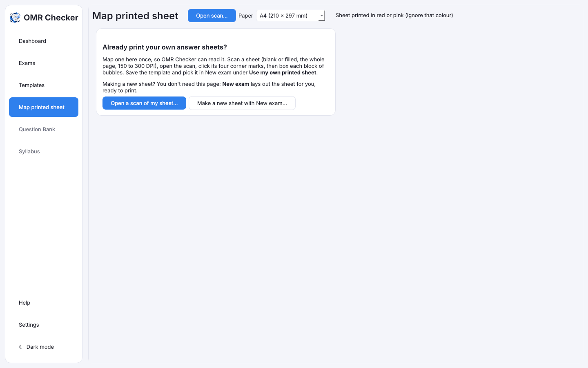

# Use a sheet you already print

[Guide home](index.md) · Previous: [Print the answer sheets](print-sheets.md) · Next: [Scan the filled sheets](scanning.md)

**Skip this page** if you let OMR Checker make your sheets with New exam. It is only for schools
that already print their own OMR sheets and want to keep using them.

**Map printed sheet** teaches the app where the bubbles are on your sheet. You do it once per sheet
design. The result is a template you can pick in New exam under **Use my own printed sheet**.

## What you need

A flat scan of one whole sheet, blank or filled, at 150 to 300 DPI. Your sheet needs a mark in
each of its four corners (a black square or circle).

## Steps

1. Open **Map printed sheet** in the sidebar and press **Open a scan of my sheet…**
   (or **Open scan…**). Pick the **Paper** size.
2. **Click the four corner marks.** If you click the wrong place, press **Start corners again**.
3. **Drag a box around each block of bubbles**: the roll number block, the set code block (if any)
   and each block of questions. The app finds the bubbles inside and guesses what each block is.
4. Check the list on the right and fix anything it guessed wrong: what the block is, and the
   question numbers it covers. **Remove block** deletes a box. A second block of digit columns is
   taken as a numeric answer.
5. If the sheet prints the roll number as a **barcode or QR code**, press **Box the barcode next**
   and draw a box around it.
6. Press **Test on this scan**. It reads your scan with the new template so you can see it works.
7. Press **Save template…**.

Now in **New exam**, pick **Use my own printed sheet** and **Choose template…**.

## Good to know

- On a sheet with no roll number bubbles, the barcode is the roll number. With both, a page where
  they disagree goes to Review.
- Sheets with a separate orientation mark are mapped without it.
- If pages in an exam couldn't be read because students filled a different sheet, map that sheet,
  then go to **Exam settings** > **Change sheet…**. Every page is read again.

[Guide home](index.md) · Next: [Scan the filled sheets](scanning.md)
