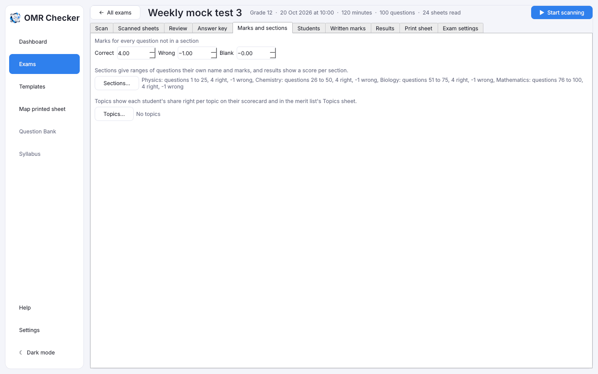
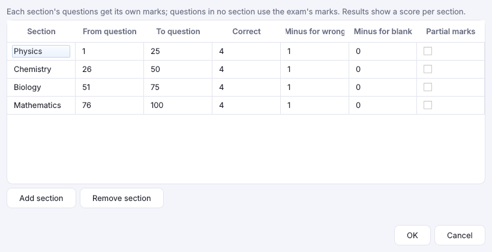
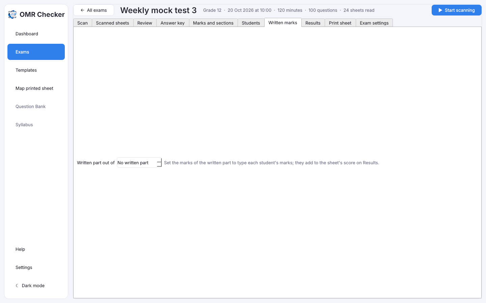

# Marks, sections, topics and written marks

[Guide home](index.md) · Previous: [The answer key](answer-key.md) · Next: [Review](review.md)

## Marks

Open the exam's **Marks and sections** tab.

- **Correct**: marks for a right answer, for example 4.
- **Wrong**: marks taken off for a wrong answer (**negative marking**). Type the number taken off,
  for example 0.25 or 1. Type 0 for no negative marking.
- **Blank**: marks for a question left empty, usually 0.

You can change the marks at any time, even after scanning. Every score is worked out again at once.

## Sections

A **section** is a group of questions with its own name and marks, for example *Physics, questions
1 to 30, 4 right, −1 wrong*. Results then show a score per section.

Press **Sections…**, then **Add section** for each one and fill in its name, first and last
question and marks. **Remove section** deletes one. Questions in no section use the exam's marks.

## Topics

A **topic** is a label for some questions, such as *Kinematics* or *Algebra*. It helps a student
see what to study.

Press **Topics…** and type one line per topic: `1-10: Kinematics`. Then:

- every scorecard shows the share of each topic the student got right;
- the Excel merit list gets a **Topics** sheet, with a row per student and one for everyone.

## Written marks

Some exams have a written (subjective) part marked by a teacher. Open **Written marks**:

1. Set **Written part out of**, for example 20.
2. Type each student's marks.

They are added to the OMR score for the rank. Results and scorecards show both parts.

[Guide home](index.md) · Next: [Review](review.md)
