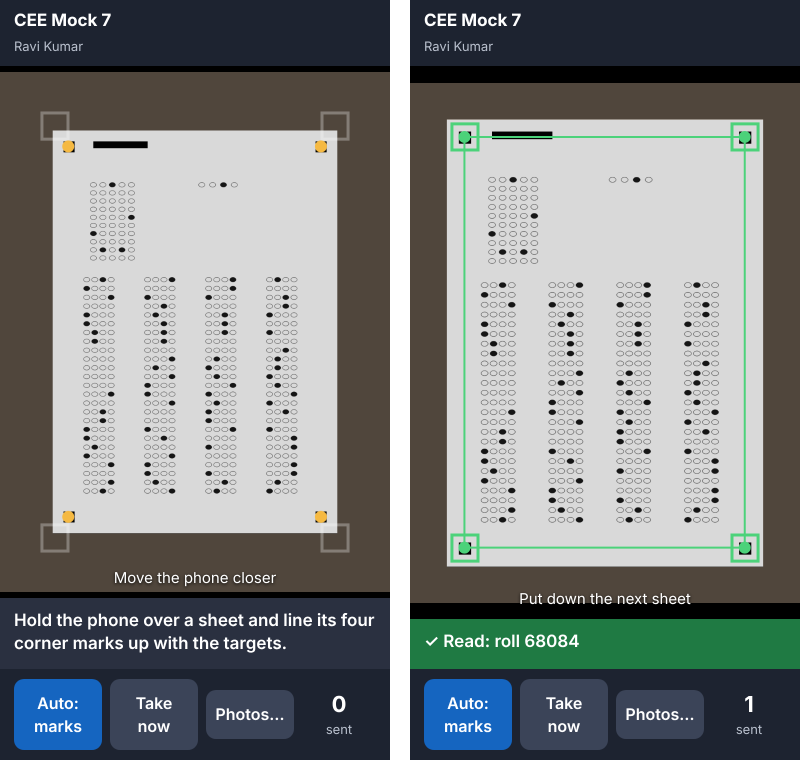

# Scan with a phone

[Guide home](index.md) · Previous: [Several PCs on one exam](several-pcs.md) · Next: [The answer key](answer-key.md)

No scanner? A phone on the same Wi-Fi as the PC photographs the sheets one after another. It needs no
app and no internet: the phone opens a page the PC itself serves.

## Start

1. Open the exam and go to the **Scan** tab.
2. Press **Scan with a phone…**. The PC shows a QR code.
3. On the phone (connected to the same Wi-Fi), point the camera at the QR code and open the link.
4. The phone warns that the connection isn't private. That's expected: the address belongs to your PC,
   not a website, so nobody on the internet vouches for it. Tap **Advanced**, then **Proceed** (on an
   iPhone, **Show details**, then **visit this website**). It asks once per phone.
5. Allow the camera.

## Photograph the sheets

The camera view shows a target for each of the sheet's four corner marks, the same shape as the
marks printed on the exam's sheet (squares or rings).

1. Put a sheet down flat in good light and hold the phone over it.
2. Move the phone until each corner mark sits in its target. A mark found but not yet in its target
   shows amber; the line under the picture says what to do: **Move the phone closer**, **Move the
   phone back a little**, left, right, up or down, or **Need more light**.
3. When all four marks are in their targets, the targets turn green. Hold still: once the marks are
   sharp, it takes the photo by itself and shows **✓ Read: roll 00195**, or **Retake** and why.
4. Put down the next sheet. It waits for the marks to leave the targets, then takes the next one.

The **Auto** button changes how photos are taken:

- **Auto: marks** (the default): as above.
- **Auto: any**: takes any picture that is bright, sharp and still, without the targets, for a sheet
  whose marks the phone doesn't find.
- **Auto: off**: press **Take now** for each sheet.

- Each photo is read on the PC straight away. A photo that can't be read isn't saved; the phone asks
  you to retake it.
- The same sheet taken twice in a row is saved once.
- The sheets appear on **Scanned sheets** as they arrive, in a batch named **Phone** with the
  operator's name and the date, and unclear marks go to **Review** as with a scanner.
- If the Wi-Fi drops, the phone keeps the photos and sends them when the PC is back. Keep the page
  open until the count stops going up.

## Without the warning: Photos…

If you'd rather not accept the warning, open the plain link shown under the QR code. The live camera
doesn't work there (browsers only allow it on secure addresses), but **Photos…** opens the phone's
own camera for each sheet, and each photo is read the same way.

## Good to know

- The PC lets the phone in while the app is open. Under **Settings**, **Other PCs…** lists each phone
  as **Phone**; **Take out** stops it.
- With logins, the phone scans as the operator logged in on the PC.
- A scanner's feeder is still the fastest way for a few thousand sheets. A phone suits a class or
  two, or a scanner that's busy.
- Like several PCs, this is for your institute's own network, not public Wi-Fi.

[Guide home](index.md) · Next: [The answer key](answer-key.md)
