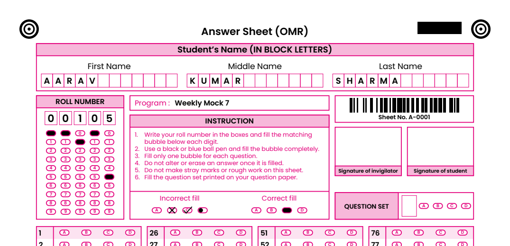

# Print the answer sheets

[Guide home](index.md) · Previous: [Templates](templates.md) · Next: [Use a sheet you already print](map-printed-sheet.md)

Open the exam and go to the **Print sheet** tab. You'll see the sheet and the buttons below it.

## Print or save as PDF

1. Pick the **Paper**: A4, Letter, Legal, A3 or A5. The sheet is scaled to fit and reads the same
   on any of them.
2. Press **Print…**, choose your printer and how many copies, and print.
   Or press **Save as PDF…** to get a file you can print later, email or take to a print shop.

The sheet still reads if the printer scales it or uses "fit to page", **as long as all four corner
circles are on the paper**. Don't let the printer cut them off.

## Test one copy first

Before printing a whole class's sheets:

1. Print one sheet.
2. Fill in a few bubbles (or leave it blank).
3. Scan it, or take a straight photo with a phone.
4. Press **Check a printed copy…** and pick that picture.

The app tells you whether the sheet reads. If it doesn't, check your printer's scaling and margins
before printing the rest.

## A sheet for each student

When the exam has a student list (the **Students** tab), tick **One sheet per student, their name
and roll number printed** on the Print sheet tab. Print or **Save as PDF…** then makes one page per
student, in roll number order:

- their **roll number** is written in its boxes and **its bubbles are already filled**, so it is
  read exactly and a student can't fill it wrongly;
- their **name** is written in the name boxes, one letter a box (a long middle name runs together);
- the exam's name is written on the **Program** line.

Hand each student their own sheet. With sheet numbers ticked, each student's page also gets the
next sheet number. A roll number that doesn't fit the sheet's roll number digits stops the printing
and says which one.

## Sheet numbers

A **sheet number** is a number printed on every copy (A-0001, A-0002, …), as text and as a
barcode. It is optional. It helps you find a missing or repeated sheet after scanning.

To use it, tick **Print a sheet number on every sheet** in the exam's **Sheet look** step (or in a
template on the Templates screen). The Print sheet tab then shows three more boxes:

- **prefix**: letters before the number, such as `A-` (up to 6 letters, digits, `-` or `/`).
  Leave it empty for plain numbers.
- **from**: the first number.
- **Copies**: how many sheets. Each page gets the next number.

So prefix `A-`, from `1`, copies `120` prints A-0001 to A-0120.

When you scan, the number is read back and shown on **Scanned sheets**, **Results**, the CSV and
the Excel merit list. Above the scanned sheets, the app lists:

- numbers found on more than one page (a sheet scanned twice?),
- numbers missing between the lowest and highest scanned (a sheet not scanned?),
- numbers that couldn't be read.

A sheet number that can't be read never changes anyone's marks; it is only listed.

[Guide home](index.md) · Next: [Use a sheet you already print](map-printed-sheet.md)
