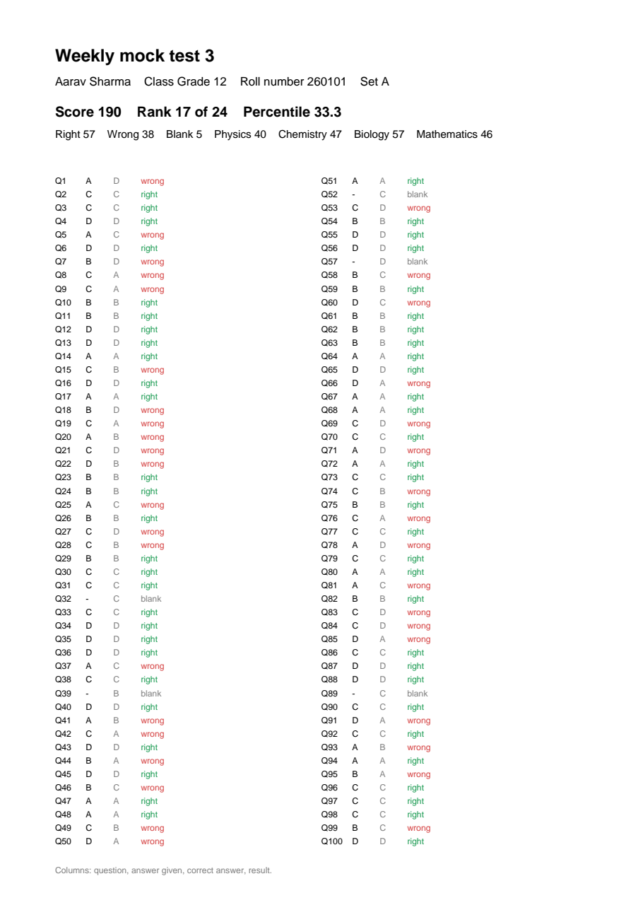

# Results, Excel, scorecards and test series

[Guide home](index.md) · Previous: [Students](students.md) · Next: [Backup, restore and settings](backup-and-settings.md)

## The Results tab

Open the exam's **Results** tab. Every sheet is ranked by score, with its rank, roll number, name,
set, score, right, wrong and blank counts, percentile, and anything still to check. With sections,
each section's score has its own column. With sheet numbers, the sheet number is shown too.

The **percentile** says what share of students scored lower. A percentile of 90 means the student
did better than 90 out of 100.

Results update by themselves when you change the key, the marks or a mark in Review. It's best to
finish [Review](review.md) first so no score is waiting on a person.

## Merit list in Excel

Press **Merit list (Excel)…** and choose where to save it. The file has:

- the **merit list**: ranks, names, scores per section, and every answer coloured green (right) or
  red (wrong);
- an **item analysis** sheet: for each question, the share of students who got it right, wrong or
  left it blank, the most chosen wrong answer, and how well the question separates strong students
  from weak ones. It helps you find a question that was too hard or had a mistake in it;
- a **Topics** sheet, if you set [topics](marks-and-sections.md#topics).

## Scorecards

Press **Scorecards (PDF)…** to save **one PDF page per student**, ready to print or send: their
score and rank, every answer next to the key and, with topics, how they did on each topic.

## CSV of every answer

On **Scanned sheets**, **Save CSV…** writes every page's score and every answer to a CSV file that
opens in Excel.

## The Dashboard

**Dashboard** in the sidebar sums up the open exam: sheets read, average score, sheets to check,
the spread of scores and recent scanning batches. Click any of them to open those sheets.

## Test series

A **test series** is a set of tests you rank together, like weekly mock tests.

1. Give each exam the same **Test series** name, in New exam or on **Exam settings**
   (**Save series**). Each new exam in the series starts with the series' student list.
2. On **Exams**, press **Test series…** and pick the series.

You get a combined ranking on total score, with each test's score (*absent* where the student has
no sheet), the number of tests taken, and the average percentage. **Series merit list (Excel)…**
saves it.

[Guide home](index.md) · Next: [Backup, restore and settings](backup-and-settings.md)
