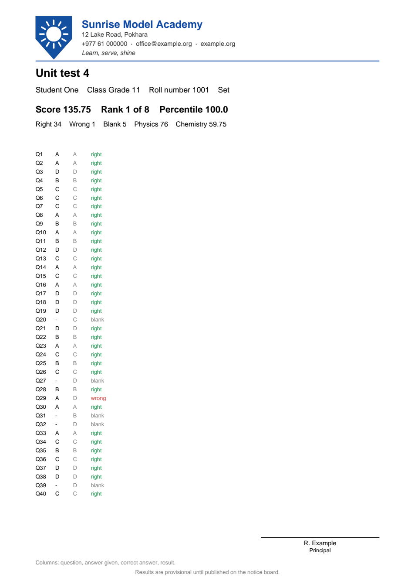
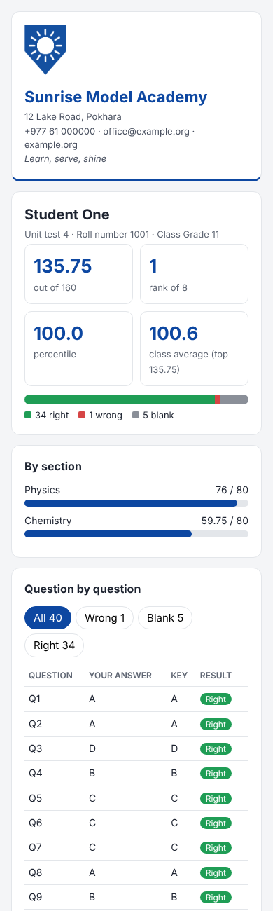
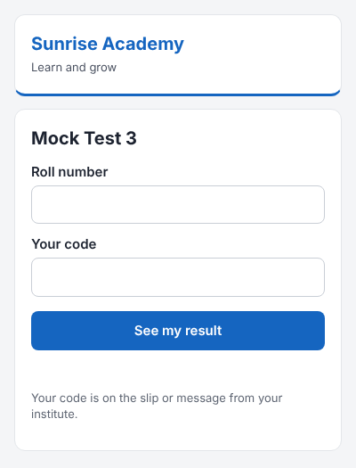
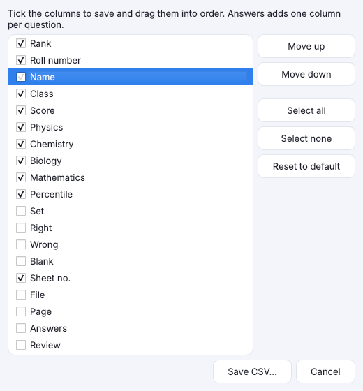
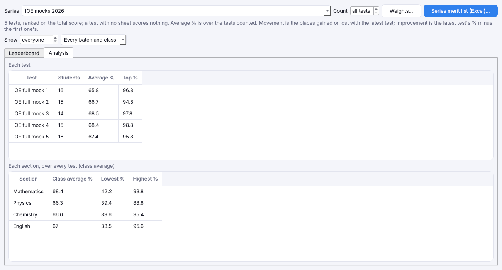

# Results, Excel, scorecards and test series

[Guide home](index.md) · Previous: [Students](students.md) · Next: [Send results by email or SMS](sending.md)

## The Results tab

Open the exam's **Results** tab. Every sheet is ranked by score, with its rank, roll number, name,
set, score, right, wrong and blank counts, percentile, and anything still to check. With sections,
each section's score has its own column. With sheet numbers, the sheet number is shown too.

The **percentile** says what share of students scored lower. A percentile of 90 means the student
did better than 90 out of 100.

Results update by themselves when you change the key, the marks or a mark in Review. It's best to
finish [Review](review.md) first so no score is waiting on a person.

## Merit list in Excel

Press **Merit list (Excel)…** and choose where to save it. The file has:

- the **merit list**: ranks, names, scores per section, and every answer coloured green (right) or
  red (wrong);
- an **item analysis** sheet: for each question, the share of students who got it right, wrong or
  left it blank, the most chosen wrong answer, and how well the question separates strong students
  from weak ones. It helps you find a question that was too hard or had a mistake in it;
- a **Topics** sheet, if you set [topics](marks-and-sections.md#topics).
- a **Batches** sheet, when the students on the exam's list are in two or more batches: each
  batch's students, average and highest score, average in each section and share right in each
  topic, side by side.

## Scorecards

Press **Scorecards (PDF)…** to save **one PDF page per student**, ready to print or send: their
score and rank, every answer next to the key and, with topics, how they did on each topic. With
[your institute](institute.md) set up, each page has its letterhead, a signature line and footer. If
the key was changed after the exam (an either answer, a bonus or a dropped question), a note on the
page says so.

## Marked sheets

Press **Marked sheets (PDF)…** to save **one page per student**: their name, roll number, score and
rank above a picture of their own sheet, with right answers ringed green, wrong ones red, the right
answer they missed in blue, and a legend. Useful for showing a student or parent exactly where marks
were lost, and for checking that every bubble was read where it was filled. A sheet whose picture
wasn't saved is left out.

## Student reports

Press **Student reports…** to make, for every student, a **report page** that opens in any phone or
computer browser, plus the same report as a **PDF**. Choose **One zip file…** to get a single file to
share, or **A folder…** to get the files loose. Each file is named by roll number (`1001.html`,
`1001.pdf`).

A report shows the student's score, rank, percentile, right, wrong and blank counts, a bar for each
section and topic, and every question with their answer and the key. The buttons above the questions
show all of them, or only the wrong, blank or right ones. It works offline: nothing is
loaded from the internet, so it is safe to send by WhatsApp or email, or copy to a pen drive.

| On a computer | On a phone |
|---|---|
|  |  |

Like the other exports, it asks first if some sheets are still waiting for Review.

### A results website students look up themselves

Choose **A results website…** and give the folder a name. You get a folder to upload to your
institute's website as it is. Its `index.html` page asks for a roll number and a code, then opens that
student's report:

- Each report's file name ends in the student's code (`1001-84QQAZ.html`), so nobody can open another
  student's report without that student's code. The pages also ask search engines not to list them.
- The codes are saved **next to** the folder, in `<folder name> codes.csv` (roll number, name, code),
  so uploading the folder never publishes them. Give each student their code, printed or in a message.
- A student keeps **the same code in every exam**, so you hand codes out once. They are made from a
  secret kept in this PC's data (and in backups); someone with only the website can't work them out.
- Upload the whole folder again after a correction; the codes stay the same.
- Your website must not list a folder's files. Most don't, and the folder's own `index.html` stops it.

## CSV with the columns you choose

A **CSV** file opens in Excel or Google Sheets. Press **Results (CSV)…** on Results (or **Save CSV…**
on Scanned sheets). A window lists every column the file can have:

- **Tick** the columns you want and untick the rest. **Select all** and **Select none** do them all
  at once.
- **Put them in order** by dragging a column up or down the list, or with **Move up** and
  **Move down**. The top of the list is the first column in the file.
- **Answers** adds one column per question (Q1, Q2, …) with what the student filled.
- **Reset to default** brings back every column in the usual order.

Press **Save CSV…** and choose where to save. Rows go best score first, then any pages that couldn't
be scored.

The app remembers your choice for each exam, so next time the same columns are already ticked.
The Excel merit list always has its full set of columns.

## The Dashboard

**Dashboard** in the sidebar sums up the open exam: sheets read, average score, sheets to check,
the spread of scores and recent scanning batches. Click any of them to open those sheets.

## Test series

A **test series** is a set of tests you rank together, like weekly mock tests.

1. Give each exam the same **Test series** name, in New exam or on **Exam settings**
   (**Save series**). Each new exam in the series starts with the series' student list.
2. On **Exams**, press **Test series…** and pick the series.

Each exam keeps its own Results tab and ranking. The series window adds them up.

**Leaderboard**: the combined ranking on total score, with each test's score and the student's
rank in that test, for example `72 (#3)`. A test with no sheet shows *absent* and scores nothing.
It also shows the number of tests taken and the average percentage.
- **Movement** shows the places gained (▲) or lost (▼) with the latest test.
- **Improvement %** is the latest test's percentage minus the first one's.
- **Show** narrows the list to the top 10 (or any number), or to one batch or class. Ranks stay the
  series ranks.

**Count**: how the total is made.
- **best N** counts only each student's best N tests, so one bad day or a missed test doesn't sink
  them. The tests left out show *not counted*.
- **Weights…** makes a test count more (2 counts double, for example the final mock) or leaves it
  out (0).

**Analysis**: how the class did in each test (students who sat it, average and top percentage) and
in each section over the whole series (class average, lowest and highest).

**Series merit list (Excel)…** saves the leaderboard and the analysis, under the institute's name.
On **Exams**, choosing a program first lists only that program's series.

[Guide home](index.md) · Next: [Send results by email or SMS](sending.md)
