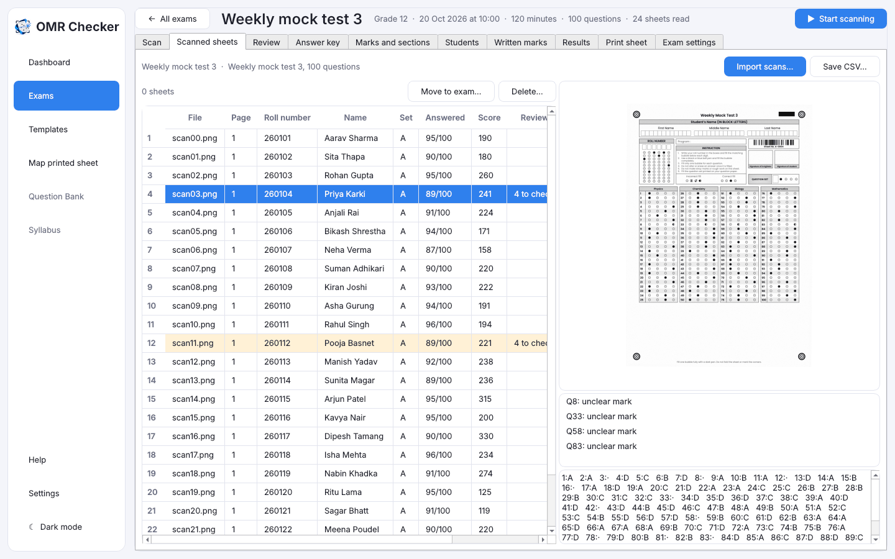
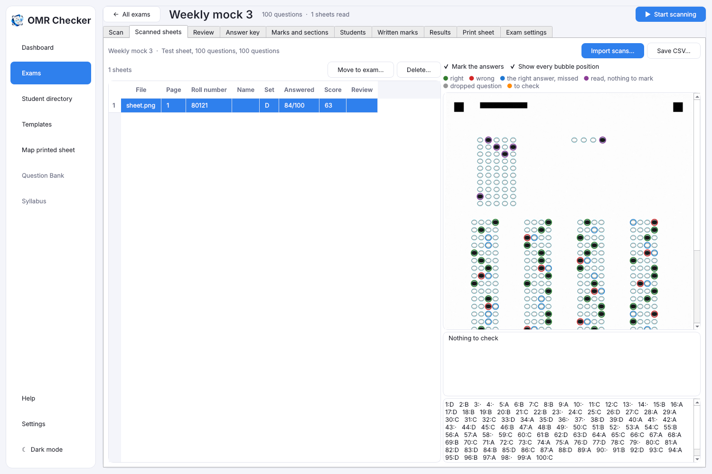

# Scan the filled sheets

[Guide home](index.md) · Previous: [Use a sheet you already print](map-printed-sheet.md) · Next: [The answer key](answer-key.md)

After the exam, the filled sheets go into the computer in one of three ways:

1. **From the scanner's feeder (ADF)**: the fastest way for a whole class.
2. **From a folder** your scanner's own software saves into, for scanners Windows can't drive directly.
3. **From files** you already have: scanned PDFs, images or phone photos.

All three end up in the same place and are read the same way.

You can scan before or after typing the answer key. Scores fill in as soon as the key is there.

## 1. From the scanner's feeder

1. Open the exam and go to the **Scan** tab.
2. Look at the line under the button. **✓ Scanner ready: …** means the scanner was found.
   If it isn't, switch the scanner on and press **Find scanners**.
3. Check the settings (you only do this once):
   - **Scanner**: pick yours.
   - **Resolution (DPI)**: 200 is right for most sheets. If your scanner doesn't take the number you
     pick, it scans at the nearest one it does (150 DPI or more reads just as well) and says so when it
     finishes. If it won't scan at 150 DPI or more through Windows, scan with the scanner's own program
     into a folder and read that folder instead (see below).
   - **Both sides (skip blank backs)**: tick this if the scanner scans both sides at once.
     Blank backs are skipped.
4. Put the sheets in the feeder, all the same way up, as your scanner's manual shows.
5. Press **▶ Start scanning**.

You'll also find **▶ Start scanning** at the top right of every exam page and on the **Dashboard**.

### What you see while it scans

- **Sheet being read**: a picture of each sheet as it arrives.
  - **Green** ring: a right answer (a bonus question counts as right).
  - **Red** ring: a wrong answer.
  - **Blue** ring: the right answer, where the student was wrong or left it blank. A number
    question's whole grid is boxed instead, with the right number written above it in blue.
  - **Purple** ring: read, but there's nothing to mark it against: the roll number, the set, or a
    question with no answer key yet.
  - **Grey** ring: an answer to a dropped question.
  - **Orange box**: something a person needs to check later, in [Review](review.md).
- Under it, the sheet's roll number, student name, set and score.
- A growing **list of sheets read**. Click one to see it again.
- Counts across the top: **Pages scanned**, **Sheets read**, **To check**, **Same roll number**,
  **Blank backs skipped** and **Sheets a minute**. Click **To check** or **Same roll number** to
  go to Review.

### Pause, Stop, and paper jams

- **Pause** stops the feeder after the current page. **Resume** carries on.
- **Stop** ends the run.
- Every sheet is **saved the moment it is read**. If the paper jams, two sheets feed together, or
  the power goes, nothing already read is lost. Clear the jam, put the remaining sheets back, and
  press **Start scanning** again.

## 2. From a folder

Use this if your scanner isn't listed but works with its own software.

1. In the scanner's software, set it to save each scan as a PDF or image into one folder.
2. On the Scan tab, set **Scanner** to **A folder my scanner software saves into**.
3. Press **Choose…** and pick that folder.
4. Press **Start watching the folder**, then scan as usual with the scanner's software.

Each file is read as soon as it is saved, with the same live view.

## 3. From files you already have

Press **Import scans…** (or **Ctrl+O**) and pick PDF, PNG, JPG or TIFF files. Phone photos work for
a few sheets: take them straight from above, in good light, with all four corner circles in the
picture.

The files are read one page at a time in the same live view.

## No scanner found?

If you press **Start scanning** and no scanner can be used, the app explains why and offers three
ways on: **Import scans…**, **Choose folder…** or **Find scanners**.

## The scanner is found but won't feed

Scanner drivers pick the feeder in different ways, and the app tries each in turn. If none works,
it says so, and saves what the driver offers in `scanner-details.txt` in the app's data folder
(the message shows where). Scan with the scanner's own program into a folder in the meantime, and
send that file with your report so support for your scanner can be added.

If the driver takes the feeder but not both sides, the fronts are scanned and the app says so when
the feeder is empty.

## After scanning: Scanned sheets

The **Scanned sheets** tab has a row for every page: file, page, roll number, name, set, questions
answered, score, what to review, and the sheet number (if used). Highlighted rows have something to check; click a row to see
the page, marked in the same colours, with a legend underneath.

- **Correct a roll number or name in place**: double-click the cell (or select the row and press
  **F2**), type, and press **Enter**. It is saved at once. For a roll number you can leave out the
  leading zeros (type `16` for `0016?`); the change is logged like a correction on Review. A name is
  saved to the [Student directory](students.md), and to the exam's own student list if it has one.
- **Names** come from the exam's student list, or else from the Student directory by roll number, so
  once your students are in the directory every sheet shows its name.
- **Handwritten names** in the name boxes of sheets made in OMR Checker are read too, on this PC, but
  never trusted on their own. Where the roll number has no student, the Name shows in grey with a
  **?**:
  - If the writing clearly fits a student in the directory, you see that student's name. Hover it
    for their roll number; Review shows it next to an unclear roll number and fills it in for you
    to save.
  - Otherwise you see the letters as read. Handwriting is read about 4 letters in 5 right, so check
    each one: correct it in place, or select rows and press **Use names read** to save them to the
    directory as shown.
- **Mark the answers** turns the colours on and off, to see the sheet as it was scanned.
- **Show every bubble position** draws a thin circle where each bubble was read. Every circle
  should sit on a printed bubble. The reader follows a curled or stretched page row by row, by up
  to 3 mm. If the circles still sit off the bubbles, the printed sheet doesn't match the exam's
  sheet: see [Map my printed sheet](map-printed-sheet.md).

- Select rows and press **Delete…** to remove pages, such as a sheet scanned twice.
- **Move to exam…** moves selected pages to another exam that uses the same sheet, for sheets
  scanned into the wrong exam.
- If some pages couldn't be read, a note explains why, with a **Map my printed sheet…** button
  for sheets other than the exam's own.

[Guide home](index.md) · Next: [The answer key](answer-key.md)
