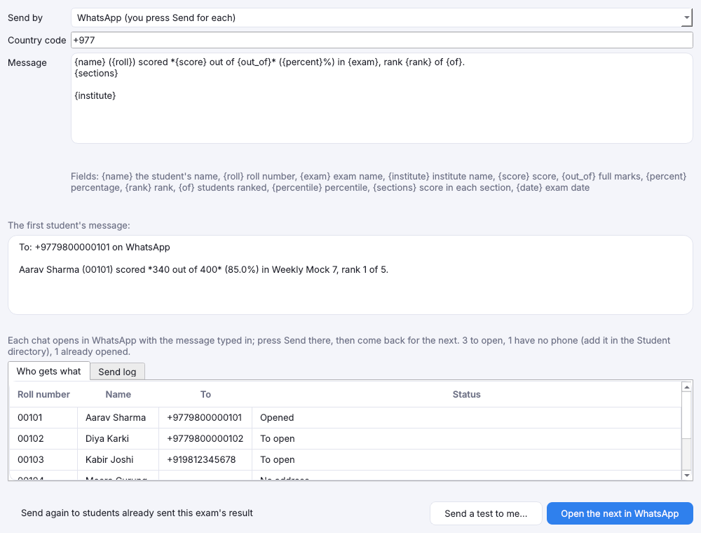
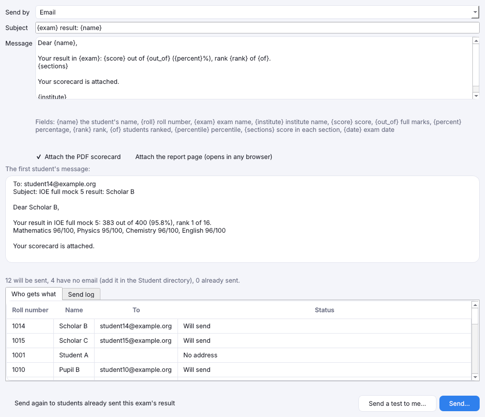

# Send results by WhatsApp, email or SMS

[Guide home](index.md) · Previous: [Results](results.md) · Next: [Your institute](institute.md)

OMR Checker can open each student's result in WhatsApp, ready for you to send, email it with their
scorecard attached, or text it to their phone. WhatsApp needs no setting up; email and SMS are **off
until you set them up**, and the rest of the app works without them, offline. Messages go from your
own WhatsApp, email account or SMS account; nothing passes through any server of ours.

## 1. Add emails and phone numbers

Students need an email or phone in the [Student directory](students.md#the-student-directory) (or
in the Excel list you import into an exam). A student with neither is listed as *No address* and
skipped.

## 2. Set up email

Open **Settings**, and on the **Send results** row press **Email…**.

1. Pick your **Provider**: Gmail, Google Workspace, Microsoft 365 / Outlook, Zoho Mail, a bulk
   service (Amazon SES, Brevo, Mailgun…) or Other. The server, port and sending limits fill in.
2. Type the **User name** and **Password**. Gmail and Outlook need 2-step verification and an
   **app password**, not the account's own password.
3. Type the **From address** and **From name** (your institute). **Reply to** and **Copy to** are
   optional.
4. Press **Send a test email…** to your own address, then **Save**.

The password is kept in **Windows Credential Manager**. It is never saved in your exams, your
backups, the settings file or the send log.

### Limits

**At most** sets how many emails go out a minute, an hour and a day. The provider's preset keeps a
little under its published limit (Gmail about 500 a day, Google Workspace about 2,000). The app
counts every email sent from this PC that day, over all exams, and waits or stops before the
limit. A big batch that passes the day's limit carries over: open **Send to students…** the next
day and it goes on with the students not sent yet.

### Your own domain: SPF, DKIM and DMARC

An address like `results@your-institute.edu.np` is still sent through whoever hosts its email, and
they set the limit; it isn't unlimited. Three DNS settings tell other mail servers the email really
comes from you, so scorecards don't land in spam. Your email provider gives the exact values.

- **SPF** lists the servers allowed to send for your domain. Add a bulk service here if you use one.
- **DKIM** signs each email; the provider gives a key to add.
- **DMARC** says what to do with email that fails the other two. Start with `p=none`.

## 3. Set up SMS

On the same row press **SMS…** and pick the **Service**:

- **Twilio**: the **Account SID** (starts with AC), the **auth token** (or an API key SID and its
  secret), and the Twilio number to **Send from**, with its country code.
- **Sparrow SMS (Nepal)**: fills in Sparrow's address and fields; type your **sender ID** and
  **token**. Check with Sparrow which reply means sent; by default any successful reply counts.
- **Another gateway**: any SMS provider with a web address. Type its **Address**, **Method**,
  **Headers** (one `Name: value` a line) and **Body**, putting `{to}`, `{message}`, `{sender}` and
  `{key}` where the gateway wants the number, the text, the sender ID and the API key. With a
  `Content-Type: application/json` header the body is JSON; otherwise a form. **Sent when the reply
  has** is text the gateway's answer must contain to count as sent.

**Country code** (for example `+977`) is put in front of numbers saved without one. Leave it empty
for a gateway that wants local numbers. **Send a test SMS…** texts your own phone.

**India:** every SMS must use a DLT-registered template and sender ID. Register your result
message with your provider first and make the message match it exactly.

An SMS holds 160 plain characters, or 70 when it has Devanagari or other non-Latin letters; the
preview says how many SMS each message takes.

## WhatsApp

WhatsApp needs nothing set up: pick **WhatsApp** in **Send by** on the send window (below).

- Type your **Country code** (for example `+977` or `+91`) once; it goes in front of phone numbers
  saved without one.
- Press **Open the next in WhatsApp**. The student's chat opens in the WhatsApp app (or WhatsApp
  Web) with their result typed in. **Check it and press Send in WhatsApp**, then come back and open
  the next. Nothing is sent without you pressing Send.
- Each chat opened is logged as *Opened* and isn't offered again, unless you tick **Send again**.
- `*stars*` around words make them bold in WhatsApp. The scorecard can't be attached this way; send
  the [student report](results.md) file yourself if you want it in the chat.

The app opens chats one at a time on purpose: WhatsApp blocks numbers that send many messages
automatically. Fully automatic sending needs Meta's paid WhatsApp Business service, which this app
doesn't use.

## 4. Send

On the exam's **Results** tab, press **Send to students…**.

1. Pick **Send by**: Email, SMS or WhatsApp.
2. Edit the **Subject** and **Message**. Fields in braces are filled for each student: `{name}`,
   `{roll}`, `{exam}`, `{institute}`, `{score}`, `{out_of}`, `{percent}`, `{rank}`, `{of}`,
   `{percentile}`, `{sections}` and `{date}`. A misspelt field is shown at once.
3. For email, tick **Attach the PDF scorecard** and/or **Attach the report page**.
4. Read the first student's message under the text, and **Who gets what**: *Will send*,
   *No address*, *Already sent*, or *Shares an address* (for example two siblings with one parent's
   email; each still gets their own message).
5. Press **Send a test to me…**: the first student's message goes only to you.
6. Press **Send…** and type the number of messages to confirm.

Messages go one at a time within the limits. **Stop** stops after the one being sent. The **Send
log** tab lists each message with its time and result, and why one failed.

- Nothing can be sent while marks still wait on [Review](review.md): a result sent can't be taken
  back.
- **Each student gets the result once.** Send… again goes only to students not sent yet, for
  example after a failure or the next day. To send everyone again (say after a key change), tick
  **Send again to students already sent**.
- If the server or gateway refuses the account or can't be reached, sending stops and says why,
  rather than failing every student. Fix the settings and Send… goes on.
- The message you write is kept with the exam for next time.

[Guide home](index.md) · Next: [Your institute](institute.md)
