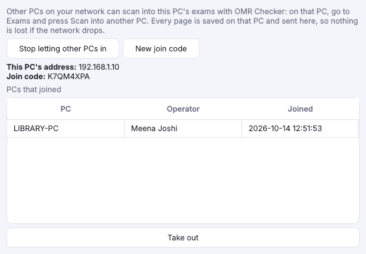
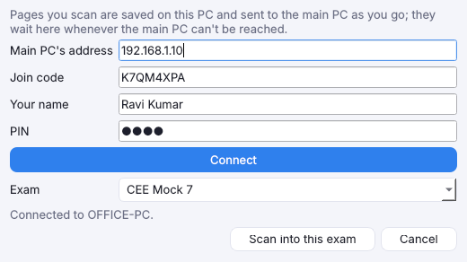

# Several PCs on one exam, and logins

[Guide home](index.md) · Previous: [Scan the filled sheets](scanning.md) · Next: [Scan with a phone](phone-scanning.md)

After a big mock test you can scan on two or three PCs at once, each with its own scanner, into one
exam. One PC keeps the exam (the **main PC**); the others scan into it over your office network. Only
OMR Checker is needed on each PC.

## On the main PC: let the other PCs in

1. Go to **Settings** and press **Other PCs…** on the **Logins and PCs** row.
2. Press **Let other PCs scan into this PC**. The window shows this PC's address and a **join code**.

Leave the app open on the main PC while the others scan. It keeps letting PCs in each time it opens
until you press **Stop letting other PCs in**. If Windows asks whether OMR Checker may use the
network, allow it on private networks.

- **PCs that joined** lists each PC and who joined it. **Take out** stops that PC sending pages.
- **New join code** stops new PCs joining with the old code; PCs already joined keep working.

## On a scanning PC: scan into the main PC's exam

1. Go to **Exams** and press **Scan into another PC…**.
2. Type the main PC's address and join code, and your name and PIN if the main PC has logins.
3. Press **Connect**, pick the exam and press **Scan into this exam**.

The exam opens on this PC with the main PC's sheet, answer key and student list, and you scan as
usual. The Scan tab says how many pages are waiting to go:

- Every page is **saved on this PC first**, then sent. If the network drops or the main PC is off,
  pages wait here and go by themselves when it is back. Nothing is lost, and a page is never saved
  twice on the main PC.
- The main PC shows the pages as they arrive, in a batch named after the scanning PC and operator.
- **Check sheets and see results on the main PC.** A correction made on a scanning PC stays on that PC.
- Opening the exam again on the scanning PC fetches the main PC's latest answer key and list.

The exam is found again on the scanning PC's Exams page next time.

## Logins

With **operators**, the app asks who is using it each time it opens, and every correction and key
change is logged under that name.

1. Go to **Settings** and press **Operators…**.
2. Press **Add…** and give a name, a PIN (4 or more numbers or letters) and a role. The first
   operator must be an **admin**.

| Role | Can |
|---|---|
| **Admin** | Everything. |
| **Operator** | Scan, review and see and share results. Can't change the answer key or marks, delete sheets or exams, restore a backup, or manage operators and PCs. |

A scanning PC signs in to the main PC with a name and PIN from the main PC's list. Only the PIN's
fingerprint is kept, never the PIN itself; an admin can give anyone a new PIN with
**New PIN or role…**. Removing every operator turns logins off.

## Keep it on your own network

The join code and PINs keep strangers out, but what goes between the PCs isn't encrypted. Use it on
your institute's own network, not on public Wi-Fi.

[Guide home](index.md) · Next: [Scan with a phone](phone-scanning.md)
