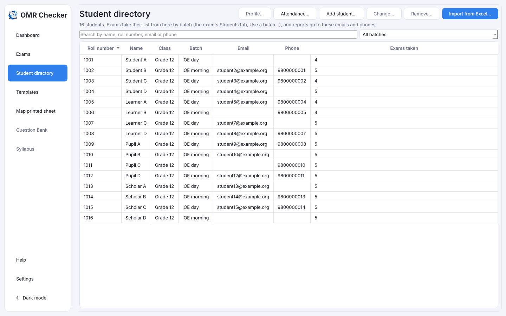
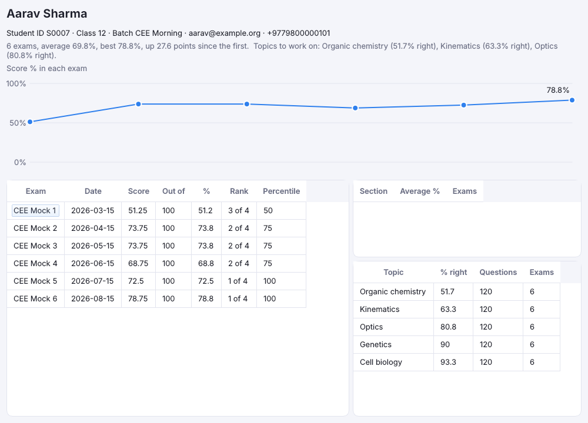

# Students

[Guide home](index.md) · Previous: [Review](review.md) · Next: [Results](results.md)

A student list is **optional**. Without one, results show roll numbers only. With one, every result
and scorecard shows the student's name, and the app can tell you who was absent.

## The student directory

**Student directory** in the sidebar keeps your institute's students once, for every exam: their
**Student ID**, name, class, **batch** (for example "CEE morning" or "IOE weekend"), **email** and
**phone**.

The Student ID stays with the student for good: use your registration or admission number, or leave
it empty and the app numbers them S0001, S0002 and so on. Directories from before Student IDs keep
their roll numbers as the IDs.

### When roll numbers change from exam to exam

Tick **Roll numbers change from exam to exam** at the top of the directory if your students sit under
a new roll number in each exam. Then:

- Each exam's **Students** list says who sits under each roll number, and links each row to a
  directory student (the **Student ID** column). Double-click that cell to link a row by hand.
- A sheet whose roll number isn't on the list has no student until you say who it is. On
  **Scanned sheets** the name written on the sheet is matched against the whole directory; select
  the row and press **Use names read** to put that student on the exam's list under that roll
  number (**Review** has the same button). Typing a name does the same: a name the directory has
  once links to that student, and a new name adds a new student.
- Results, a student's profile, attendance, **Exams taken**, the test series merit list and the
  contacts results are sent to all follow the Student ID, so a student who sat as 105 in one test
  and 212 in the next is one person.

Leave it unticked if a student keeps one roll number: a roll number that isn't on an exam's list is
then the student with that Student ID, as before.

- **Import from Excel…** adds a list. Students already in the directory are updated; an empty cell
  keeps what was there. An email or phone that doesn't look right is left out and listed, and the
  student is still added.
- **Add student…** and **Change…** (or double-click a row) edit one student. Phone numbers are
  saved with their country code, for example `+9779800000001`.
- **Remove…** takes students out of the directory. Exams keep their own lists and results.
- Search by name, Student ID, email or phone, or pick a batch. **Exams taken** counts the exams
  with a sheet read for that student.

### A student's profile

Choose a student and press **Profile…** (or double-click them). It shows every exam they took, with
their score, percentage, rank and percentile, a line of their percentage in each exam (point at a
dot to see the exam), their average in each section, weakest first, and, when the exams have
[topics](marks-and-sections.md#topics), their share right in each topic over every exam, weakest
first, with the three to work on named at the top. A topic named alike in several exams (say
"Kinematics" in every mock) counts as one. Sheets are matched to the
student through each exam's list, or by roll number as their Student ID (a sheet's `00123` is the
directory's `123`).

### Attendance

**Attendance…** lists a batch's students against the exams of one program (or every exam): ✓ where a
sheet was read for them, *absent* where not, and how many they sat. **Save as CSV…** saves it for
Excel, to follow up with the students who missed tests.

On an exam's **Students** tab, **Use a batch…** gives the exam the students of one batch (or
everyone). Roll numbers get back the leading zeros Excel drops, and anyone whose roll number can't
be on that sheet is listed and left out.

## Import the list from Excel

1. Make an Excel file (`.xlsx`) with a column for **roll number**, one for **name**, and,
   if you like, ones for **Student ID** (a heading with "student id", "registration", "admission"
   or "enrollment"), **class**, **batch**, **email** and **phone**. The first row holds the column
   headings.
2. Open the exam's **Students** tab and press **Import students…**.
3. Pick the file.

Rows that can't be used (for example a missing roll number) are listed for you and not imported.

Each row is linked to a directory student: by its Student ID when the file has one, else by a name
exactly one directory student has (the phone number picks between namesakes). Anyone new is added to
the directory with a Student ID. Rows whose name more than one directory student has are listed, to
link by hand in the **Student ID** column.

**Use the list of another exam…** copies a list you already imported for another exam. Exams in the
same [test series](results.md#test-series) start with the series' list.

## What the list does

- Names show on Scanned sheets, Review, Results, the merit list and scorecards.
- A sheet whose roll number **isn't on the list** goes to [Review](review.md), in case the student
  filled it wrongly.
- The **Sheet** column shows who has a sheet read.

## Who was absent

Tick **Show only absent** to see the students on the list with no sheet read.
**Save absent list…** saves them as a CSV file that opens in Excel.

[Guide home](index.md) · Next: [Results](results.md)
