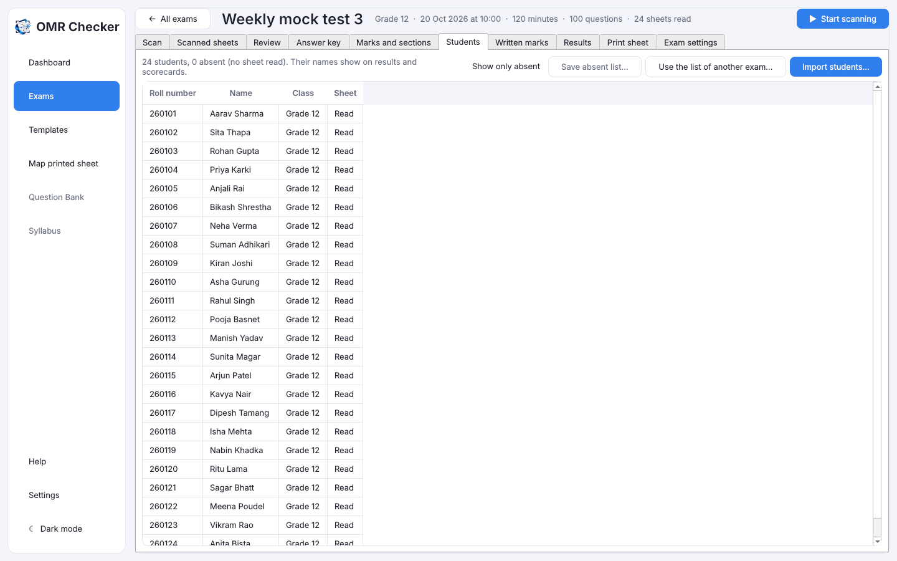

# Students

[Guide home](index.md) · Previous: [Review](review.md) · Next: [Results](results.md)

A student list is **optional**. Without one, results show roll numbers only. With one, every result
and scorecard shows the student's name, and the app can tell you who was absent.

## The student directory

**Student directory** in the sidebar keeps your institute's students once, for every exam: roll
number, name, class, **batch** (for example "CEE morning" or "IOE weekend"), **email** and **phone**.

- **Import from Excel…** adds a list. Students already in the directory are updated; an empty cell
  keeps what was there. An email or phone that doesn't look right is left out and listed, and the
  student is still added.
- **Add student…** and **Change…** (or double-click a row) edit one student. Phone numbers are
  saved with their country code, for example `+9779800000001`.
- **Remove…** takes students out of the directory. Exams keep their own lists and results.
- Search by name, roll number, email or phone, or pick a batch. **Exams taken** counts the exams
  with a sheet read for that roll number.

On an exam's **Students** tab, **Use a batch…** gives the exam the students of one batch (or
everyone). Roll numbers get back the leading zeros Excel drops, and anyone whose roll number can't
be on that sheet is listed and left out.

## Import the list from Excel

1. Make an Excel file (`.xlsx`) with a column for **roll number**, one for **name**, and,
   if you like, ones for **class**, **batch**, **email** and **phone**. The first row holds the
   column headings.
2. Open the exam's **Students** tab and press **Import students…**.
3. Pick the file.

Rows that can't be used (for example a missing roll number) are listed for you and not imported.

**Use the list of another exam…** copies a list you already imported for another exam. Exams in the
same [test series](results.md#test-series) start with the series' list.

## What the list does

- Names show on Scanned sheets, Review, Results, the merit list and scorecards.
- A sheet whose roll number **isn't on the list** goes to [Review](review.md), in case the student
  filled it wrongly.
- The **Sheet** column shows who has a sheet read.

## Who was absent

Tick **Show only absent** to see the students on the list with no sheet read.
**Save absent list…** saves them as a CSV file that opens in Excel.

[Guide home](index.md) · Next: [Results](results.md)
