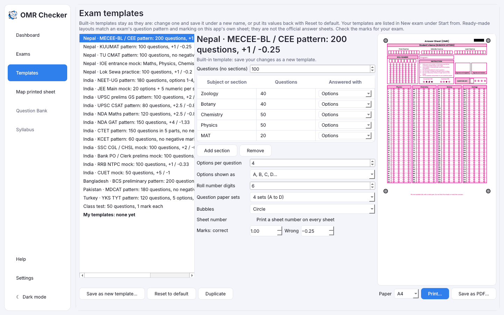

# Templates

[Guide home](index.md) · Previous: [Create an exam](create-an-exam.md) · Next: [Print the answer sheets](print-sheets.md)

A **template** is a ready-made exam pattern: the number of questions and sections, options, roll
number digits, sets, marks and the look of the sheet. Starting **New exam** from a template saves
typing.

## The built-in templates

These follow each exam's published question pattern and marking, on OMR Checker's own sheet
design. They are **not the official answer sheets** of those exams. Always check the marks for
your exam.

| Country | Templates |
|---|---|
| Nepal | MECEE-BL / CEE, KUUMAT, TU CMAT, IOE entrance mock, Lok Sewa practice |
| India | NEET-UG, JEE Main mock, UPSC prelims GS and CSAT, NDA Maths and GAT, CTET, KCET, SSC CGL/CHSL, bank PO/clerk prelims, RRB NTPC, CUET |
| Bangladesh | BCS preliminary |
| Pakistan | MDCAT |
| Turkey | YKS TYT |
| Any | 50-question class test |

## The Templates screen

Open **Templates** in the sidebar. The list is on the left; pick one to see its settings and a
preview of its sheet.

You can change: the sections (**Add section**, **Remove**), the number of questions, options per
question, how options are shown, roll number digits, question paper sets, bubble shape, the sheet
number, and the marks.

## Make your own template

1. Pick the template closest to what you want.
2. Change what you need.
3. Press **Save as new template…** and give it a name.

Your template now appears in the list and under **Start from** in **New exam**.

Built-in templates never change. If you edit one, you must save it under a new name.
**Reset to default** puts a built-in's own values back.

## Look after your own templates

For templates you made:

- **Save** keeps your changes.
- **Undo changes** puts back what was last saved.
- **Rename…** gives it a new name.
- **Duplicate** makes a copy to change.
- **Delete** removes it. Exams already made from it are not affected.

## Print a blank sheet from a template

The bottom of the Templates screen has the same **Print…** and **Save as PDF…** buttons as an
exam's Print sheet tab. See [Print the answer sheets](print-sheets.md).

[Guide home](index.md) · Next: [Print the answer sheets](print-sheets.md)
