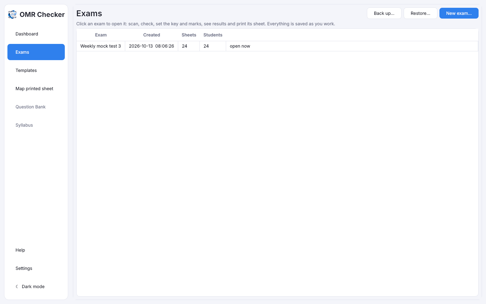

# Words to know and installing

[Guide home](index.md) · Next: [Quick start](quick-start.md)

## Words to know

You will see these words in the app and in this guide.

| Word | What it means |
|---|---|
| **OMR** | *Optical mark recognition*: a computer reads which bubbles are filled on a paper sheet. |
| **OMR sheet** or **answer sheet** | The paper students fill in, with rows of bubbles. |
| **Bubble** | A small circle (or oval, or box) the student fills in to choose an answer. |
| **Option** | One of the choices for a question, such as A, B, C or D. |
| **Answer key** | The list of right answers, one per question. The app marks every sheet against it. |
| **Roll number** | The student's number. They fill it in as bubbles at the top of the sheet. |
| **Set** (question paper set) | A version of the paper with the questions in a different order, so students sitting next to each other can't copy. Each set has its own answer key. |
| **Section** | A group of questions with its own name and marks, for example *Physics, questions 1 to 50*. |
| **Negative marking** | Marks taken off for a wrong answer, for example 0.25 or 1. |
| **Template** | The layout of a sheet: how many questions, options, roll number digits and sets, and where every bubble is. The app makes one for every exam. |
| **Scanner** | The machine that turns paper into a picture on the computer. |
| **ADF** | *Automatic document feeder*: the tray on top of many scanners that pulls in a pile of sheets one after another. With an ADF you can scan a whole class without touching each sheet. |
| **DPI** | *Dots per inch*: how sharp a scan is. 200 DPI is right for OMR sheets. |
| **WIA** | The standard way Windows talks to scanners. If Windows itself can scan with your scanner, OMR Checker can too. |
| **PDF** | A file that keeps a document exactly as it prints. |
| **Review** | The list of things the app wasn't sure about, for a person to decide. |
| **Merit list** | The list of students ranked by score. |
| **Scorecard** | One page per student with their marks. |
| **CSV** | A simple table file that Excel opens. |

## The one rule the app follows

OMR Checker **never guesses**. If a bubble is half filled, faint, or two bubbles are filled where
only one is allowed, it doesn't pick one for the student. It puts that question in
[Review](review.md) and shows you that part of the sheet, and you decide.

## Installing

Download the file for your computer from the project's
[Releases page](https://github.com/crispin0007/omr/releases/latest) (once a release is published).
The [README](../README.md#install) has the full list, including Mac and Linux.

### On Windows

1. Download `OMR-Setup-<version>.exe`.
2. Double-click it. If a blue box says **"Windows protected your PC"**, press **More info**, then
   **Run anyway**. This appears because the app is free and not signed with a paid certificate.
3. Follow the steps: **Next** on the welcome page, accept the licence, keep the
   suggested folder, and tick **Create a desktop shortcut** if you want one. It needs nothing else:
   no Python, no internet.
4. Leave **Start OMR Checker now** ticked on the last page and press **Finish**. Later, open it from
   the Start menu.
5. Connect your scanner with its USB cable and switch it on. If Windows can scan with it (try the
   Windows **Scan** app or **Windows Fax and Scan**), OMR Checker will find it.

The app works fully **offline**. Nothing is uploaded anywhere.

**Updating:** run the new version's setup file. Your exams and settings are kept.

**Removing:** Windows Settings > Apps > OMR Checker > Uninstall. It asks whether to delete your exams
too. Press **No** to keep them (for example, before reinstalling).

**No installing allowed on this PC?** Use the portable zip, `OMR-Portable-<version>.zip`: unzip it to
a USB stick or a folder you can write to and run `OMR.exe`. Its exams stay in the `data` folder
beside it.

### On a Mac

1. Download the `.dmg` for your Mac: **apple-silicon** for M1 or newer (Apple menu > About This Mac
   says "Chip: Apple M…"), **intel** for older Macs.
2. Open it and drag **OMR Checker** onto **Applications**.
3. The first time only: in Applications, right-click **OMR Checker** and choose **Open**, then
   **Open** again. On macOS 15 or newer, if it only offers **Done**, press it, then go to **System
   Settings > Privacy & Security**, scroll down and press **Open Anyway**.
4. Macs can't scan straight from a scanner's feeder in OMR Checker. Scan with **Image Capture** or the
   scanner's own app into a folder, and pick that folder on the Scan tab (see
   [Scan the filled sheets](scanning.md#2-from-a-folder)).

### On Linux

- **Ubuntu, Debian or Linux Mint:** double-click `omr-checker_<version>_amd64.deb` to install it, or
  run `sudo apt install ./omr-checker_*.deb`. OMR Checker then appears in the app menu.
- **Other Linux:** download the `.AppImage`, make it runnable (right-click > Properties > allow
  running, or `chmod +x`), and double-click it.
- Scan with **Simple Scan** (Document Scanner) into a folder and pick that folder on the Scan tab.

## Finding your way around

The **sidebar** on the left opens the main screens:

- **Dashboard**: a summary of the open exam.
- **Exams**: the list of your exams, where you make new ones.
- **Templates**: ready-made exam patterns and your own.
- **Map printed sheet**: for a sheet you already print yourself.
- **Help** (F1) and **Settings**.

Click an exam to open its **exam page**. Its tabs, from left to right, are: Scan, Scanned sheets,
Review, Answer key, Marks and sections, Students, Written marks, Results, Print sheet and Exam
settings. **← All exams** goes back to the list.

[Guide home](index.md) · Next: [Quick start](quick-start.md)
